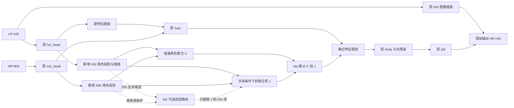

# D2：基于当前 Net 的分阶段代码修改方案

日期：2026-10-06。性质：实施前的探索性方案；尚未实现新增网络，尚未训练，也没有新增指标结果。

**先做动机一的最小结构版本，与你的原始 Net 配对比较；结果有希望，再做动机二。动机三单独进入自监督训练轨道，不与前两步同时实施。**

本方案使用 research-pipeline-planner 的轻量规划模式，以及 research-experiment-plan 的对照、消融和决策门槛要求。论文代码按固定 GitHub 提交检查，详见[论文代码依据](D:/coding/github_self/thesis_base_line/research/d2_net_modification_plan_20261006/paper_code_evidence.md)。本次只新增研究文档和计划数据，不修改任何 Python 文件。

## 1. 先明确本地代码现状和三个动机的实现边界

### 1.1 你的网络文件是 model.py，Net 是其中的类

当前目录没有 Net.py。后文“改 Net”指改造 [model.py 中的 Net](D:/coding/github_self/thesis_base_line/model.py:57)，不是覆盖一个不存在的 Net.py。

| 位置 | 当前代码 | 本方案如何处理 |
|---|---|---|
| model.py:17 | ChannelAttention | 完整复用，不增加或替换内部注意力 |
| model.py:38 | ResBlock | 完整复用，两层卷积、GELU、通道注意力和残差都保留 |
| model.py:81 | hsi_head | 完整复用；先在 LR 上提取 64 通道特征 |
| model.py:87 | msi_head | 完整复用；在 HR 上提取 64 通道特征 |
| model.py:93 | fuse | 保留原来的 128→64、3×3 卷积，不用新模块覆盖它 |
| model.py:96 | body | 保留 8 个 ResBlock，模块名称和权重尺寸不变 |
| model.py:98、100 | body_out、tail | 完整复用；最终仍输出 31 波段修正量 |
| model.py:106、108 | 两次双线性上采样 | 第一阶段保持 align_corners=False；坐标对齐实验另做 |
| model.py:112 | 拼接后的融合特征 | 动机一新增模块的主要插入点 |
| model.py:116 | hsi_up + tail(f) | 保留全局残差，不改变输出含义 |

记输入为低分辨率 HSI `L` 和高分辨率 MSI `M`。当前流程是：

```text
L → hsi_head → F_H_low → 双线性上采样 → F_H ┐
                                            ├→ fuse → F_0 → body/长残差 → tail → ΔX
M → msi_head ────────────────────────→ F_M ┘
L → 双线性上采样 → U(L) ────────────────────────────────────────────────＋→ X_hat
```

`F_H_low:[B,64,h,w]`，`F_H/F_M/F_0:[B,64,H,W]`，`X_hat:[B,31,H,W]`。默认训练块是 LR 8×8、HR 64×64、倍率 8。原模型参数量为 831,071。

**原始 Net 已经可以隐式学习跨模态交互；不能把它描述为完全没有光谱—空间联系。** 新增结构的任务是检验显式路径是否更容易学到有效配合，而不是证明原模型不能配合。

### 1.2 当前训练有 HR 标签，先把结构验证和自监督结论分开

[train_cave_M.py:142](D:/coding/github_self/thesis_base_line/train_cave_M.py:142) 调用 `cnn(a2, a3)`，下一行用 HR-HSI `a1` 计算 L1。因此，直接换 Net 后跑出的结果属于**有监督结构验证**。

| 阶段 | 对应动机 | 主要修改 | 能否只改新 Net 并沿用现有损失？ | 得到什么证据 |
|---|---|---|---|---|
| M1-A，首轮推荐 | 来源分开后保留必要配合 | 来源角色投影＋残差交互接口 | 可以；接入时只需更换模型导入 | 显式结构是否有指标收益；尚未证明解耦取舍 |
| M1-B，机制验证 | 哪种分离会妨碍配合 | 观测角色辅助头＋分离位置/强度对照 | 不可以，必须让训练器加入相应损失 | 合理分离约束与任务配合的具体关系 |
| M2，第二轮 | 光谱修正分配到空间位置 | 交互前的局部光谱路由 | 可以继续沿用首轮损失 | 局部关系是否改善分配误差与指标 |
| M3，后续独立轨道 | 没有 HR 标签时如何训练 | 同一 Net＋观测/内部训练/联合目标 | 不可以，必须改训练和数据接口 | 无 HR 标签条件下结构和训练机制是否有效 |

M1-A 中暂称“共享候选/互补候选”，这些只是来源明确的可学习通道。**命名四个分支不会自动形成语义解耦。** M1-B 才补充可检查的角色依据；如果不做 M1-B，论文应将首轮方法定位为来源条件交互结构。

## 2. 推荐创建新网络，完整保留原网络作为对照

### 2.1 未来文件组织，不在本次创建 Python 文件

```text
model.py                  原始 baseline，保留
model_d2.py               未来新增：NetD2、SourceRoleProjector、TaskInteractionBridge
                          后续追加 LocalSpectralRouter、ObservationRoleHeads
train_cave_M.py           结构试跑：未来仅切换导入；公共评估流程修正对所有模型一致
train_d2_selfsup.py        M3 时才新增；与当前有监督训练入口分开
physics_d2.py              M1-B/M3 才新增：匹配当前成像算子的可微 R、D
```

推荐在 `model_d2.py` 中从 `model.py` 导入原 `Net`，定义 `NetD2(BaselineNet)`，调用父类构造函数后只追加模块。最后可以设置 `Net = NetD2` 作为兼容别名。这样原有 `hsi_head.*、msi_head.*、fuse.*、body.*、body_out.*、tail.*` 的 state_dict 名称保持不变。

首轮接入计划：把训练文件第 4 行的 `from model import Net` 改成 `from model_d2 import Net`。它会同时作用于第 92 行计算复杂度的模型和第 121 行实际训练模型，避免统计一种结构、训练另一种结构。当前调用参数 `Net(31,3)` 保持有效。

### 2.2 接口约定

```python
# 下面仅是未来接口，不是本次已实现代码。
NetD2(spn=31, ch=3, dim=64, num_blocks=8,
      role_dim=32, bridge_enabled=True, router_enabled=False,
      router_window=3, return_aux=False)

prediction = net(lrhs, hrms)                 # 默认只返回 Tensor
prediction, aux = net(lrhs, hrms, return_aux=True)  # 以后用于损失和诊断
```

原调用和 `utils.reconstruction()` 都要求输出是 Tensor，不能默认返回多个张量。`return_aux=True` 必须显式开启；不在 forward 中自动计算损失、调用 backward、读取真值或积累带计算图的历史状态。

新增功能逐步启用：

| 版本 | bridge | router | role loss | HR 标签 |
|---|---:|---:|---:|---:|
| E0 原始对照 | 关 | 关 | 无 | 有 |
| E1 M1-A | 开 | 关 | 无 | 有 |
| E1-role M1-B | 开/关对照 | 关 | 有，单独加入 | 结构验证阶段可有 |
| E2 M1＋M2 | 开 | 开 | 与被比较的 E1 保持一致 | 与 E1 保持一致 |
| SS0/SS1/SS2 M3 | 分组开启 | 分组开启 | 另行冻结 | 无，不能沿用 HR 预训练权重 |

完整目标结构可按下面的图理解；M2 只替换 J 读取的 HSI 候选，C 继续读取原始角色：



## 3. 动机一：先添加来源角色投影与任务交互接口

### 3.1 第一轮具体想检验什么

> 在保留原始融合通路和所有残差块的条件下，给两种来源的互补候选特征增加一个受共享候选调节的联合路径，是否比原始 Net 和同规模普通加参更有效？

这是一项可落地的结构假设，不等于“证明分离破坏了配合”。首轮不加分离损失，不引入退化估计，不上扩散模型，也不增加多层 Transformer。

### 3.2 新增 SourceRoleProjector

使用四个独立的 `1×1 Conv＋GELU`：

| 投影 | 输入 | 输出 | 暂定作用 |
|---|---|---|---|
| h_shared | F_H_low，64 通道 | S_H_low，32 通道 | HSI 的共享候选 |
| h_private | F_H_low，64 通道 | P_H_low，32 通道 | HSI 的光谱互补候选 |
| m_shared | F_M，64 通道 | S_M，32 通道 | MSI 的共享候选 |
| m_private | F_M，64 通道 | P_M，32 通道 | MSI 的空间互补候选 |

将 `S_H_low、P_H_low` 用与原 Net 相同的双线性配置上采样为 `S_H、P_H:[B,32,H,W]`。HSI 的两个新投影在 LR 上计算；原有 `F_H_low→F_H` 路径继续保留。

不要直接把 64 个通道前 32 个称共享、后 32 个称互补；原特征通道没有这种预先语义。也不要硬阈值删掉低权重通道。

### 3.3 新增 TaskInteractionBridge

新接口包含一个普通聚合项和一个联合项，两者都输出 64 通道：

\[
C=W_C[S_H,S_M,P_H,P_M]
\]

\[
G=\sigma(W_G[S_H,S_M]),\quad
A=\tanh(\mathrm{LN}_c(P_H)),\quad
B=\tanh(\mathrm{LN}_c(P_M))
\]

\[
J=W_J(G\odot A\odot B),\qquad
F_1=F_0+\eta(C+J).
\]

实现规格：

- `W_C`：1×1 卷积，128→64，bias=True。
- `W_G`：1×1 卷积，64→32，再 Sigmoid。
- `LN_c`：两个独立的 LayerNorm(32)，每个空间位置沿通道归一化。实现时 BCHW→BHWC→LayerNorm→BCHW，不能直接把 LayerNorm(32) 套在 BCHW 的最后一维上。
- `W_J`：1×1 卷积，32→64，bias=True。
- `η`：独立可学习标量，初值 0。不对最终预测使用 Sigmoid，不把修正量限制为正数。

`G` 根据共享候选决定当前位置需要多少联合修正，`A⊙B` 给出两种候选同时参与的路径。它是潜在特征交互，**不是把 32 个潜在通道解释为 32 种材料，也不是真实光谱基与丰度的分解**。

`tanh` 限制乘积幅度，有利于首轮训练稳定；但可能饱和，所以必须记录其绝对值接近 1 的比例。原始融合路径完整保留，接口只是增加修正。

### 3.4 Net.forward 的逐行修改位置

未来 override forward 的计划如下。所有未列出的原有模块照常使用：

```python
H, W = hrms.shape[-2:]
hsi_up = interpolate(lrhs, size=(H, W), mode='bilinear', align_corners=False)
f_hsi_low = self.hsi_head(lrhs)
f_hsi = interpolate(f_hsi_low, size=(H, W), mode='bilinear', align_corners=False)
f_msi = self.msi_head(hrms)
f0 = self.fuse(cat([f_hsi, f_msi], dim=1))

# 新增部分；关掉 bridge 时不进入它，直接 f=f0。
roles = self.source_role(f_hsi_low, f_msi, output_size=(H, W))
f = f0 + self.bridge_scale * self.interaction_bridge(roles)

f = f + self.body_out(self.body(f))
prediction = hsi_up + self.tail(f)
return prediction
```

以上是位置与顺序说明，`cat/interpolate` 等名称是伪代码。实际实现还需处理关闭开关、return_aux 和 M2 路由。**接口放在原 fuse 后、body 前**：保留未压缩的两路特征作为接口输入，再让原 body 处理联合修正。首轮不在每个 ResBlock 中重复插入模块。

### 3.5 初始化与权重兼容，容易踩坑的地方

1. 只将 `η` 置零；新卷积保留正常初始化。若同时把所有接口输出权重置零，可能让 η 和接口一起无法打开。
2. η=0 时，新增分支内部参数首个反向通常得到零梯度，η 本身可以有非零梯度；打开后分支应开始得到梯度。这是计划中的启动行为，不能把首步内部零梯度误判为实现失败。
3. 当前训练第 124 行遍历 Conv/Linear 做 Xavier 初始化。不要依赖在新模块构造器中给卷积置零的做法，这些权重随后会被覆盖；独立 nn.Parameter 的 η 不受这段规则影响。
4. 首轮配对实验先生成一份初始化后的原 Net 权重，再按键名复制到各候选的公共模块。仅使用相同 seed 不够：新增层会消耗随机数，当前整网初始化的遍历顺序也会改变原模块权重。
5. `load_state_dict(..., strict=False)` 后检查：unexpected_keys 必须为空；missing_keys 只能属于新模块。不能忽略所有报错，更不能按两个字典的遍历顺序 zip 加载。
6. 主比较从共同随机初始化训练；旧 baseline checkpoint 微调只能作为额外探索。不能把微调候选与从零训练对照混比。
7. bridge 关闭时，复制公共权重后的输出应与原 Net 一致；η=0 且全部新功能关闭/无辅助损失时也应一致。这个检查不代表开启后的网络有效。

### 3.6 参数与计算预算

上述精确定义下，dim=64、role_dim=32：

| 新增部分 | 参数量 |
|---|---:|
| 四个 64→32 的 1×1 投影 | 8,320 |
| 聚合 W_C，128→64 | 8,256 |
| 门控 W_G，64→32 | 2,080 |
| 两个 LayerNorm(32) | 128 |
| 联合输出 W_J，32→64 | 2,112 |
| η | 1 |
| 合计 | **20,897** |

因此首轮候选理论参数量为 **851,968**，比原始模型多约 2.51%。这是按指定层配置计算的预算，尚不是新 Net 的实测统计。参数少不意味着推理必然更快；实际 MACs、训练显存、整图重建时间需要之后测量。

### 3.7 首轮最小对照与判断门槛

你可以先只实现 E1 并手动跑一次，但必须同时有同协议 E0。一次上升仅能决定是否值得继续，不能形成稳定增益结论。

| Run | 结构 | 用途 |
|---|---|---|
| E0 | 原始 Net | 必须保留的主对照 |
| E1 | 本节完整 bridge，role_dim=32 | 你首先要跑的候选 |
| E1-add | 同样角色投影、门控和输出；将 G⊙A⊙B 改为 G⊙(A+B)/2 | 同参数加性接口；对照可以胜出 |
| E1-mlp | 在 F0 后增加 64→160→64 的 1×1 MLP/GELU 残差＋η | 20,705 个新增参数，接近 E1；排除普通加参解释 |
| E1-no-role，后续可选 | 直接两路投影交互，不组织共享候选 | 判断四路角色组织是否必要 |

`E1-add` 没有显式乘积，但整个 Net 的 body 仍是非线性的；不能声称它完全不能学习联合响应。`E1-mlp` 使用同样 η=0 启动规则。所有主对照保留原始 ChannelAttention，不同时替换激活函数、上采样和 body 深度。

首轮探索门槛预先定为：验证集同一 checkpoint 上，平均 PSNR 比 E0 至少提高 0.10 dB、RMSE 不升，平均 SAM 的相对恶化不超过 1%；同时检查逐场景是否大面积退化。0.10 dB 是继续投入的工程门槛，不是显著性标准，也不是承诺效果。

- 满足门槛：进入 E1-add/E1-mlp；再进行 3 个配对种子，例如 3407、2026、17。至少 2/3 个种子 PSNR 增量为正，再判断 M2 是否值得投入。
- 增量在 0～0.10 dB：保留原始日志，先重复/做简单对照，不急着叠 M2。
- PSNR 明显下降或 SAM 恶化：先查 η、门控饱和、初始化、数据和保存；可把 role_dim=16 作为一次明确记录的参数变化。修复后仍无收益，回到原始 Net，停止这条累加路线。
- E1-add/E1-mlp 同样或更好：保留能提高指标的最简单结构，但不能宣称特定联合机制已被证明。

这些判断以验证集为主；当前 12 个测试场景已被历史工作查看，若继续使用只能作为既有探索集，不能把它们包装为完全未见的确认性测试。

## 4. 动机一的完整机制验证：M1-B，不要求你首轮就做

### 4.1 为什么不能靠 Net 命名完成这一部分

四个角色投影没有角色目标时可能学习相似内容、交换意义，或被原始通路绕过。η≈0 也可能让分支基本闲置。因此，E1 指标提高只能证明候选结构有用，不能证明共享/互补真的被分离。

若想研究“哪些分离会妨碍配合”，需要让角色有观测依据，并直接比较分离位置/强度。首轮无收益时不为讲故事强行增加这些约束。

### 4.2 以后新增 ObservationRoleHeads，角色目标只来自观测

记光谱响应为 `R:[3,31]`，`Q=I-R†R`。本项目 R 满行秩；Q 提取的是 **R 不可见的光谱分量**，不等于全部光谱细节，更不等于纯材料信息。

| 辅助头 | 输入 | 目标 | 注意 |
|---|---|---|---|
| shared_h_readout，32→3 | S_H_low | R L | 在 LR 原尺寸，避免伪造 HR 共享标签 |
| private_h_readout，32→31 | P_H_low | Q L | 可正可负，使用线性输出 |
| shared_m_readout，32→3 | S_M | D(输出) 匹配 D M | 先通过第 7 节的 D 一致性检查 |
| detail_m_readout，32→3 | P_M | M−U(D M) | 有符号细节目标；这不严格属于 ker(D) |
| rec_h，64→31 | [S_H_low,P_H_low] | L | 防止只顾区分而丢失观测信息 |
| rec_m，64→3 | [S_M,P_M] | M | 同上 |

首版辅助头都使用 1×1 线性读出，先避免用强解码器把不含信息的特征“救回来”。各项采用元素均值 L1，再求平均形成 `L_role`；完整性重建两项单列日志。共享两路在 LR 的目标 `R L` 与 `D M` 理想情况下可交换一致，但必须检查实际退化、边界和块坐标。

未来总损失示意：`L=L_task+α L_role+λ L_sep`。`L_task` 在当前结构验证轨道是 HR-L1；在 M3 轨道是无 HR 的观测/内部损失。**仅创建这些辅助头而不改训练 loss，不会让它们学习角色目标。**

未来训练接入最小变化是：显式调用 `prediction,aux=cnn(...,return_aux=True)`，用原主损失得到 L_task，再通过角色读出头和固定观测目标得到 L_role，最后相加后 backward。`aux` 至少包含 `S_H_low、P_H_low、S_H、P_H、S_M、P_M`；辅助头只读这些特征和训练观测，不读 HR 角色标签。可以在 Net 上提供 `compute_role_losses(aux,L,M,physics)` 方法，由训练器显式调用；该方法返回各项 loss 字典，不自动更新参数。默认 α=0.1 作为探索起点，λ=0 先跑 role-only；后续 λ 用固定梯度比规则确定。各项幅度与主任务损失必须分别记录。

### 4.3 分离约束怎样借鉴 MossFuse，怎样与它区分

MossFuse 固定提交的 `utils.py:82` 对共享候选做正向相似、对共享/互补与跨来源互补做排斥。可以将这一思想作为**对照约束**，不是直接认定它有害。

迁移时按每个样本展平特征计算 cosine，使用 logsumexp 写稳定损失，避免原代码把整个 batch 展成一个向量。这个改动必须声明，结果不能标成原版 MossFuse 复现。

至少保留：

| 比较 | 角色目标 | 分离目标作用位置 | 联合接口 |
|---|---|---|---|
| D0 | 相同 | 无 | 相同开关 |
| D1 | 相同 | 直接作用于重建使用的 S/P 特征 | 相同开关 |
| D2 | 相同 | 作用于额外角色投影 z(S/P) | 相同开关 |

投影分离不自动保护重建：梯度仍会传回原特征，投影还可能以常数方向满足 cosine。所有组都配置同样的 z 头和读出头；z 也要通过可变观测角色目标的线性读出检查，并记录样本方差、读出误差、特征范数。不能用一个输出常数正向量、另一个输出负向量就宣称成功解耦。

每组再比较 bridge 开/关；λ=0 的角色辅助模型必须有。强度用相对于主任务梯度的比值记录，先比较 0、0.01、0.1 三档；1 或更大只做压力诊断，不作为核心论证。固定前 100 个训练 batch 的探测流程、参数集合和随机种子校准 λ，之后冻结；主梯度近零时记录并跳过比值，不除以极小数制造强约束。

如果弱直接分离与投影方案一样好，或者合理强度下没有可重复的空间分配代价，应放弃“分离伤害配合”的因果叙述。可以保留结构收益，但应改写贡献。

### 4.4 联合配合怎样测，不能只看特征 cosine

使用第 6.4 节的四组生成方式构造一致成像的诊断任务，每一组都由同一个 Z_ab 生成 `(D Z_ab,R Z_ab)`，不要独立乱交换 HSI/MSI 后把不一致输入当成真实材料变化。监督结构轨道可用冻结验证场景的 HR 块作为 Z；无 HR 轨道只能用观测 L 的内部块，结论相应限定到内部尺度。

比较完整四组的重建误差，以及 `Delta_prediction-Delta_Z` 的混合响应误差。补充没有乘法项的加性四组对照；其正确混合目标为零，应报告绝对误差，不能除以零目标。生成种子、光谱/空间模式、块坐标在看模型结果前固定，不能挑“某模型失败”的样本。

如果分离组只是整体重建更差，不能直接推断特定配合受损；需同时看完整误差、角色读出与局部错误。若加入这些四组作为训练数据，所有比较组使用相同四组、相同普通目标与前向预算，并把诊断模式/场景独立留出。单纯 mixed response 正确而四组都存在共同偏移，不算完整任务恢复成功。

角色监督和上述诊断能减少解释歧义，但仍不能证明某一潜在通道就是某种真实材料。论文机制表述应限制在声明生成任务及自然图像的实际证据范围。

## 5. 动机二：在动机一接口中加入局部光谱路由

### 5.1 改什么，不改什么

在通过首轮门槛的结构上，新增 `LocalSpectralRouter`。位置在角色投影之后、交互乘积之前。

第一版**只改变联合项 J 使用的 P_H**；普通聚合 C、原始 fuse、body、tail、全局残差都不变。这样可以追问“局部搬运光谱候选信息是否有用”，而不是同时改变整条网络。

SHOTUN 的代码依据是跨块自表达关系和后续聚合；本方案取其“保留位置关系”的问题意识，提出受两种观测共同条件化的局部版本。它不是 SHOTUN 的张量展开复现，也不称为新的自表达理论。

### 5.2 模块的具体形状和计算

设角色宽度 d=32，query/key 宽度 r=16，默认邻域 3×3，共 K=9 个位置。

\[
T=[S_H,S_M],\quad q=W_qT,\quad k=W_kT
\]

\[
a_{p,j}=\operatorname{softmax}_{j\in\mathcal N(p)}
\left(q_p^\top k_j/\sqrt r+b_{j-p}\right)
\]

\[
V_p=\sum_{j\in\mathcal N(p)}a_{p,j}P_{H,j},\quad
\widetilde P_H=P_H+\rho(V-P_H).
\]

用 `tanh(LN_c(tilde_P_H))` 替代 J 中原来的 HSI 项；C 仍使用原 P_H。

实现时给 bridge 的 forward 增加 `private_h_for_joint=None` 可选参数，而不是在 roles 字典中覆盖 P_H。C 一律使用 `roles['P_H']`，J 使用可选替代值；否则会无意同时修改 C，失去本阶段的单因素设计。

| 张量/参数 | 尺寸/定义 |
|---|---|
| T | [B,64,H,W] |
| q、k | 两个独立 1×1 Conv 64→16，[B,16,H,W] |
| unfold(k) | [B,16,9,H×W]，必须明确 reshape 顺序 |
| unfold(P_H) | [B,32,9,H×W] |
| a | [B,9,H×W]，沿 9 个邻居做 softmax |
| relative_bias | 9 个可学习参数，初值 0 |
| rho | 一个标量 Parameter u，rho=tanh(u)，u 初值 0；不要 Sigmoid(0)=0.5 |
| V/tilde_P_H | [B,32,H,W] |

允许 rho 为负表示反向局部修正，因此不把最终路径解释为严格概率混合；a 本身才是归一化邻域权重。若需要凸混合，可另设 [0,1] 约束并单独做实验，不在同一次跑分里悄悄更换。

边界使用有效邻居 mask，把图像外 key 的 logit 置为负无穷；每个位置至少保留自身，不允许全被遮掉。不能把补零位置当作真实相似材料。移除无效项后的权重和应为 1。

初始化 u=0 时，tilde_P_H=P_H，复制 E1 权重后 E2 起点与 E1 一致。先有 u 梯度，随后 query/key 分支打开；检查这条启动链，不同时将 q、k 全部置零。

### 5.3 为什么需要两种来源共同决定路由

仅以 MSI 相似度找邻居，可能把 MSI 响应相近但真实光谱不同的区域混在一起。HSI 提供额外光谱线索，所以默认 query/key 同时读取两路共享候选。

但这种条件化不能唯一恢复所有细粒度材料：低分辨率 HSI 本身可能混合，R 也存在零空间。这个模块只能学习数据先验下更合理的局部分配，不能保证凭三通道 MSI 区分所有光谱。

首版不使用 HR 真值建立邻接图，不把网络预测误差最小的位置当作“可信邻居”，也不新增材料类别标签。

### 5.4 复杂度、分块和容易出现的失败

指定两层 q/k、9 个偏置和 u 时新增参数为 2,090；M1＋M2 理论参数量 854,058。局部计算约随 H×W×K 增长，而不是构建所有像素之间的矩阵。

尽管参数少，unfold 会放大激活：batch=16、d=32、64×64、K=9 时，仅 values 展开就有 18,874,368 个 float32 元素，约 72 MiB，还未计梯度和 keys。3060 显存是否足够须实测。首版只在原有 64×64 推理块内计算，不直接展开 512×512 整图；后续可分空间块计算局部路由，但需验证 halo 和数值一致性。

可能失败包括：平滑了边界、低分辨率光谱不足以判邻居、重复纹理误匹配、路由退化成始终选自己，以及学习到的补偿主要来自原上采样坐标偏差。后者必须与“改善材料分配”区分。

### 5.5 第二轮对照和评估

| Run | 对照 | 要排除什么 |
|---|---|---|
| E2 | E1＋共同条件的局部路由 | 主候选 |
| E2-uniform | 相同邻域，邻居均匀权重，rho 学习 | 收益是否只是局部平滑 |
| E2-msi | query/key 只使用 S_M | MSI 相似度是否足够 |
| E2-hsi | query/key 只使用 S_H | HSI 条件是否已有全部收益 |
| E2-conv | 用小型深度卷积残差调整 P_H | 普通局部建模是否足够 |

单来源对照保留同样 64 通道 q/k 输入尺寸，用复制的同来源特征填满，不减少参数；说明信息输入有变化而参数数目不变。均匀权重/卷积对照的预算另行报告。

整体仍看 PSNR↑、RMSE↓、SAM↓；补充预先定义的边缘区域和内部区域误差。边缘 mask 从输入 MSI 的梯度计算，阈值只用训练/验证数据冻结；不能根据测试误差挑区域。该 mask 是结构代理，不能当作真实材料边界。

SAM 按像素光谱计算，局部 RMSE 采用固定 0–255 尺度。分区必须覆盖全部有效像素；区域为空时报告数量和缺失，不当作零误差。保存全部场景，不只展示最显著的图片。

继续门槛：验证集相对 E1 的 PSNR 增量至少 0.10 dB、整体 RMSE 不升、SAM 相对恶化≤1%，同时边缘光谱误差没有系统恶化；然后再做 3 个配对种子和上述对照。若指标提高主要来自平滑或坐标补偿，不能据此确认动机二的解释。

M2 是局部重新分配，不是学习图像配准。当前数据没有人为几何失配，不应为了借鉴未配准论文而额外添加光流分支。

## 6. 动机三：让同一 Net 在没有 HR-HSI 标签时得到训练依据

### 6.1 先换训练协议，再判断结构有没有用

**M3 无法只通过修改 Net 实现。** 需要新训练入口和只返回观测的训练数据对象。不能把 HR-L1 保留，再称为自监督；不能用 HR 训练的 E1/E2 checkpoint 初始化“从无标签学习”的主实验。

未来训练入口只读 `L、M、R、D`；模拟观测时可能需要原 HR 文件，但训练器接收的对象不含 HR 张量。真值放在独立评估路径，冻结设置后才能读取。若使用当前按整幅 HR 最大值归一化的模拟数据，应披露这个生成步骤；不能拿它冒充未知真实传感器的归一化。

建议保留三个逐级训练条件，而不是一口气同时加三种 loss：

| 条件 | Net | 损失 | 用途 |
|---|---|---|---|
| SS-obs | 原始/改进 Net 各自同协议 | L_obs | 无 HR 的观测一致性参照 |
| SS-int | 与上组相同 | L_obs＋内部重建 L_int | 观测 HSI 是否提供有用的尺度先验 |
| SS-joint | 与上组相同 | 完整四组内部目标＋L_obs＋λmix L_mix | 联合训练机制是否比相同普通目标更有效 |

### 6.2 观测损失：借鉴 CLoRF 的双观测训练，不照搬其坐标网络

\[
L_{obs}=\operatorname{mean}|D(\widehat X)-L|
+\lambda_m\operatorname{mean}|R\widehat X-M|.
\]

原 Net 和改进 Net 都计算相同目标。初始两项权重可设为 1，再根据固定的验证规则选择；不同通道/尺寸都用元素均值，不能一个求和、一个均值导致无意改权重。训练预测不 clamp，评估依旧采用统一裁剪。

严格无 HR 轨道的选模规则与监督阶段不同：SS-obs 先采用预先固定的 step 预算并保存 last，不按 HR PSNR 选 best；SS-int/SS-joint 如需要调权重，使用独立验证场景的**观测 HSI 内部任务**，按完整内部重建误差选择，不只看 L_mix，也不看隐藏 HR。初始 λ_int=1；L_mix 先比较 λ_mix=0 与 0.1，必要时增加 1 这一档，所有组搜索预算相同。设置冻结后再由评估路径报告 HR 指标。若之后根据 HR 指标改变方案，记录为新的探索选择，不能继续宣称该选择过程完全无 HR。

CLoRF 原代码使用 MSE、坐标表示和 TV，本方案只借鉴观测保真结构。将 MSE 换成 L1、保留卷积 Net 是明确的迁移设计，不是复现论文成绩。

仅 L_obs 小不说明 HR 重建正确。对满足 `RZ=0、DZ=0` 的变化，观测可能无法区分 X 与 X+Z；新模块和损失不能凭空创造不存在的信息。

### 6.3 内部重建：目标来自已观测的 LR-HSI

取当前观测 L 的较大块为内部目标 Z，构造：

\[
L_{int}^{input}=D_{int}Z,\quad M_{int}^{input}=RZ,\quad
L_{int}=\operatorname{mean}|Net(D_{int}Z,RZ)-Z|.
\]

这里 Z 是观测 HSI，不是隐藏 HR 真值。将内部低分辨率任务学到的关系迁移到原尺度，需要尺度先验；是否成立必须看自然图像结果。

尺寸必须重新考虑：当前 64×64 HR 训练块对应 L 只有 8×8，再降 8 倍只剩 1×1。**不能直接从当前 a2 的 8×8 块构建主要内部训练任务。**

应先对整幅 512×512 场景形成完整 64×64 的观测 L，再在其上取 32×32 内部目标、stride=16；得到 4×4 的内部 HSI 输入和 32×32 的内部 MSI 输入。64×64 内部目标作为尺寸敏感性实验，来自真实完整观测，而不是把 8×8 插值伪造成 64×64。

项目 `RealDATAProcess2` 已经有二次退化思路，但直接复用前需核对：它将传入 MSI 继续 D 下采样，而不是自动构造 RZ；其返回顺序是 `(target, msi, lrhsi)`，与当前 `(target, lrhsi, msi)` 不同。不能把已有二次退化当新创新，也不能只换类名而不检查顺序。

原尺度观测损失计算须先整图退化再取块，或保留足够的 halo；不能对每个裁剪块用独立对称边界 D，然后无条件与整图裁剪的 L 比较。详见第 7 节。

### 6.4 联合目标的候选构造：给出能实现的版本，但不预设有效

在内部目标 Z 上产生四组受控变化。一个保守、可计算的生成器是：

\[
\bar Z=Z/[(1+\alpha)(1+\beta)],\qquad
Z_{ab}=\bar Z\odot(1+a\alpha s)\odot(1+b\beta t),
\quad a,b\in\{0,1\}.
\]

`s:[31,1,1]` 是有界的平滑光谱扰动，`t:[1,h,w]` 是有界空间模式，两者在 [-1,1]；可从预先固定的低频基/随机种子生成，不读取 HR。首版 α=β=0.1 仅为探索起点。Z∈[0,1] 时四组仍在 [0,1]，不用 clamp 改写目标。

对每个 Z_ab 构造同样 `(D_int Z_ab, R Z_ab)`，网络输出 Xhat_ab。完整内部重建先覆盖全部四组；混合目标为：

\[
\Delta Z=Z_{11}-Z_{10}-Z_{01}+Z_{00}
=\alpha\beta\bar Z\odot s\odot t,
\]

\[
L_{mix}=\operatorname{mean}|\Delta\widehat X-\Delta Z|.
\]

这个标签来自**声明的生成先验**。乘法构造只是一个候选受限族，不代表自然场景的材料变化遵循同一公式，也不能保证任务在所有观测下可辨识。实现前检查目标幅度、观测变化、明显冲突输入和网络可学性；非零目标过小/不可学时记录失败，不用极大权重强行优化。

对照必须使用相同四组样本、相同完整目标、相同前向次数：A 只用四组普通 L_int，B 在其上加 L_mix。**四组完整标签已经给出时，L_mix 不增加独立真值，检验的是结构化优化的价值。** 另外保留无混合项的加性生成负对照，以及原始 Net 与改进 Net 的 2×2 结构/训练对照。

L_mix=0 也不能证明完整恢复：四个预测共同偏移时，混合差分仍可能正确，因此完整四组误差和原尺度观测误差必须一起报告。

第一轮内部训练先固定全部候选相同的 2,000 个 optimizer steps 做可学性筛查；后续共同使用 10,000 步作为探索预算，四组前向的额外计算分别记录。不能直接与有监督的 2,000 epoch 横比，也不能给联合组额外完整目标、额外训练时间后归因于 L_mix。

### 6.5 CDPS 与 Equivariant Splitting 的实际迁移范围

CDPS-train 的空间数据入口只读 HRMSI，光谱数据入口只读 LRHSI，支持“先验来自观测”的训练组织。当前公开仓库的 spatial_sample.py 是扩散采样示例，本轮没有在所读代码中确认完整耦合后验融合入口。因此不计划把 CDPS sampler 直接移植到小 Net，也不把其方法优势当作当前卷积机制的保证。

Equivariant Splitting 的 splitting/model-adaptation 思想说明训练目标与重建结构需要匹配。其 MRI 实现涉及噪声模型、mask 和适配后的模型；不能直接复制到当前无噪声、双传感器、偶数核下采样设置，也不能照搬无偏结论。首版 M3 不引入 deepinv 依赖。

普通旋转/翻转增强也不自动满足当前 D 的等变条件：偶数核、采样相位和边界会影响 D(TX) 与 T(DX) 的关系。若后续加等变损失，先检查算子交换关系或显式变换传感器几何，再开实验。

## 7. 所有阶段共用的实验协议与最低限度修正

### 7.1 数据、训练预算和选模

可复用已有[场景级清单](D:/coding/github_self/thesis_base_line/research/d2_feasibility_and_story_20261006/experiment-plan/split-manifest.csv)：16 train / 4 validation / 12 legacy test。新的 baseline 和候选都用这个划分重跑；旧 20/12 的 48 dB 记录不能作为新划分下的直接差值基准。

当前 dataloader 使用 os.listdir 前 num 个文件，不能只把 num 改成 16 就假定符合清单。未来需要按显式清单读取或构建单独目录；路径里的空格按真实文件名保留。

结构阶段先保留 Adam、lr=1.5e-4、weight_decay=1e-8、batch=16、Cosine 每 iteration 更新、训练 2,000 epoch、训练块 64、stride=32。如显存不够调整 batch，所有组同步重跑或使用统一梯度累积，不只改候选。

当前初始化和训练之外至少有两项公共流程修正：

1. 用 4 个验证场景选模，不用 cave_test 反复选最优。相同 checkpoint 报全部指标。
2. 验证 PSNR 严格改善时保存 best，另外保存 last。当前 `abs(best-current)<0.15` 不是严格最佳保存条件；checkpoint 还需存模型、optimizer、scheduler、epoch/step、seed、配置、清单和随机状态。

如果你首轮为了方便完全沿用旧脚本，可以作为探索试跑，但必须新跑 E0、明确仍有测试选模偏差。这个限制不是要求你现在改训练文件；它说明怎样解读将来的数值。

### 7.2 指标与历史混杂

- 项目 PSNR 对每个波段求空间 MSE 后算 PSNR，再对波段平均；不是整幅全元素 MSE 的单次 PSNR。
- RMSE 使用 0–255 尺度；SAM 使用角度。评估裁剪规则、整图拼块顺序和重叠平均方式保持一致。
- 现有 reconstruction 有末端重复位置，且先裁剪每块再拼接；首轮不同时去重或换拼块策略。以后作为独立因素检查。
- 已有报告发现默认插值坐标与当前退化相位不一致，并在插值对照上产生大幅差异。首轮冻结坐标，不把对齐修正与新模块一起加入。网络是否已经补偿未知，不能把插值增量当作新网络预期增量。
- 原始 12 个场景已被查看过；有监督筛查和后续自监督都属于探索。若以后需要确认性结论，要再冻结未参与选择的数据/场景。

### 7.3 可微 D/R 的实施约定

R 使用 utils.create_F 的同一 3×31 数值，注册为 buffer，不让模型偷偷学习另一个 R。Q 用稳定伪逆并核对 `RQ≈0、Q²≈Q`。

D 必须匹配 `fspecial('gaussian',8,3)`、scipy `signal.convolve2d(boundary='symm', mode='same')`、`0::8` 采样。PyTorch reflect padding 与这里的 symmetric boundary 不等价；偶数 8 核的左右/上下 padding 不可直接各取 4。先用脉冲、常数、线性斜坡、随机小图对照原函数确定索引，不能凭经验写 padding=4。

算子验收：float64 最大绝对误差 <1e-10；float32 <1e-5；输出形状正确，梯度有限且可传播。这些检查在实际可微实现完成后运行，目前未运行。

裁剪的物理一致性：先整幅成像再裁剪，或者按原全局坐标带 halo 卷积后取有效目标。不要对内部裁剪边缘重复对称扩展，而拿整图退化结果作完全一致标签。内部模拟任务可以规定独立块边界，但要与原尺度任务分开说明。

## 8. 可执行的实施顺序和每一步的交付物

| 步骤 | 未来要做的事 | 主要交付物 | 下一步条件 |
|---|---|---|---|
| P0 | 冻结公共协议，补回可复测 E0 | config、split、baseline checkpoint、逐场景指标 | baseline 可复测，保存/划分一致 |
| P1 | 新建 model_d2.py，复用原 Net，加入 M1-A | 默认 Tensor 接口、关闭/η=0 等价、形状和梯度检查 | 兼容性通过 |
| P2 | 你手动跑 E1 与 E0 | 同 checkpoint 的 PSNR/RMSE/SAM、η/分支日志 | 通过第 3.7 节探索门槛 |
| P3 | E1-add/E1-mlp 与 3 seed；必要时 M1-B | 结构价值证据，或角色/分离诊断 | 不被普通加参全部解释；否则收窄贡献 |
| P4 | 加入 M2，先跑 E2/E1 | 局部/整体误差、路由与显存统计 | 通过第 5.5 节门槛后再扩展对照 |
| P5 | 新建自监督入口及算子，跑 SS0/SS1/SS2 | 标签隔离、算子预检、同协议 selfsup 指标 | M3 训练机制有增益；否则移除该机制 |

M1-B 可以在 P3 后作为机制证据支线，也可以暂时不做。若不做，允许继续研究实用的 M2，但不能将最终故事写成已验证的“分离导致错误、我们修复了它”。

每个 run 保存：run_id、父 run、模型开关、源代码摘要、checkpoint、seed、数据清单、step/epoch、损失配置、逐场景表、运行时间、峰值显存、所有失败/重试。`OOM、NaN、未跑、空区域、失败种子` 不从表中静默删除；技术重试保留原因和父 run。

### 8.1 最小形状/兼容性检查清单，留给未来实现者

| 检查 | 输入/条件 | 期望 |
|---|---|---|
| 原 Net 对齐 | 复制公共参数，bridge/router 都关 | 最大输出差≤1e-6，eval 模式 |
| 新接口初值 | η=0、router 关 | 输出与原 Net 一致；η 可有梯度 |
| 输入尺寸 | 8×8→64×64；4×4→32×32；8×10→64×80 | 输出通道 31，空间跟随 MSI |
| batch | 1 和 2，独立样本 | 默认 Tensor，batch 不混为一次 cosine |
| 初始化 | 经当前 Xavier 流程后 | η/u 仍为 0，公共参数与配对初值一致 |
| 参数集合 | 开启/关闭辅助头 | optimizer 包含应训练参数，不漏新模块 |
| M2 初值 | 复制 E1，u=0 | 与 E1 输出一致 |
| 路由边界 | 角点、边、内部 | 有效权重和=1，无 NaN，无越界真像素 |
| 存取权重 | 保存后新实例加载 | eval 输出可复现；开关/配置被保存 |
| M3 数据 | 训练数据对象 | 只含观测，HR 不进入 loss/选模 |

这些是计划中的验收，不是本次已经通过的测试。

## 9. 代码诊断日志与失败后怎么调

首轮只记录少量明确可解释的量：η、`norm(η(C+J))/[norm(F0)+eps]`、G 的均值/分位数、tanh 饱和比例、两个候选的样本方差。保存时 detach，不在模型中缓存计算图。

| 现象 | 先检查什么 | 合理下一步 | 不应立即得出的结论 |
|---|---|---|---|
| η 长期接近 0 | 分支梯度、共同初值、门控饱和 | 确认实现后比较普通接口；可记录 η=0.01 的初始化敏感性 | 不能说“已有效解耦但没提升” |
| 训练 loss 降、验证更差 | 参数/预算、过拟合、场景差异 | 同预算 role_dim=16，或回退简单对照 | 不能只挑好场景继续 |
| PSNR 升、SAM 降不下来 | 分波段与局部光谱误差 | 看是否牺牲暗区/少量波段；不继续加空间模块掩盖问题 | 不能只看 PSNR 宣称全面更好 |
| M2 边缘变锐但 SAM 更差 | 错邻居、过大 rho、坐标补偿 | 对照均匀/单来源/卷积，退回 E1 | 不能把锐利等同于正确光谱 |
| role cosine 很好但读出差 | 常数反向量、低方差、分支绕过 | 降权/修角色监督；必要时去掉分离 | 不能用 cosine 单独证明角色有效 |
| L_obs 很小但 HR 指标差 | 不可辨识、内部先验偏差、算子错误 | 查 D/R，再比较内部训练和简单先验 | 不能保证 joint loss 自动补真值 |

修改超参数必须只看训练/验证结果并记录。不要每次改变很多因素后仍沿用同一个 run_id。

## 10. 最后能形成什么贡献，哪些现在还不能写

三个动机可以保留同一主线：**区分来源 → 检查任务所需联系 → 改善光谱的空间分配 → 给出无 HR 标签的训练依据。** 但模块不是贡献的自动证明。

| 若得到的证据 | 可以保留的贡献方向 | 仍不能声称 |
|---|---|---|
| 只有 E1 比 E0 好 | 来源条件交互的结构改进 | 首次提出共享/互补或跨模态乘积；分离有害 |
| M1-B 在合理强度下出现可重复取舍，接口能改善 | 具体分离位置/约束与联合重建的任务取舍 | 所有解耦都损害融合，或 MossFuse 必然有此问题 |
| M2 在公平局部对照下改善光谱分配代理误差 | 光谱证据条件化的局部交互设计 | 完整识别材料、解决任意几何失配 |
| M3 同四组/同预算优于普通训练 | 声明先验下的联合训练机制 | 从观测无条件恢复唯一 HR 真值；无偏保证 |

最值得优先实现的是第 3 节 M1-A。它能完整复用你当前 Net，新增层少、回退容易、可以直接看数值。若这一步没有稳定收益，就不把动机二、三当作必须叠加的任务。

具体运行表和决策门槛另见[实验计划](D:/coding/github_self/thesis_base_line/research/d2_net_modification_plan_20261006/experiment-plan/experiment-plan.md)、[执行桥接](D:/coding/github_self/thesis_base_line/research/d2_net_modification_plan_20261006/experiment-plan/execution-bridge.md)。本轮审查为同一代理自审，不是独立科学验证。
