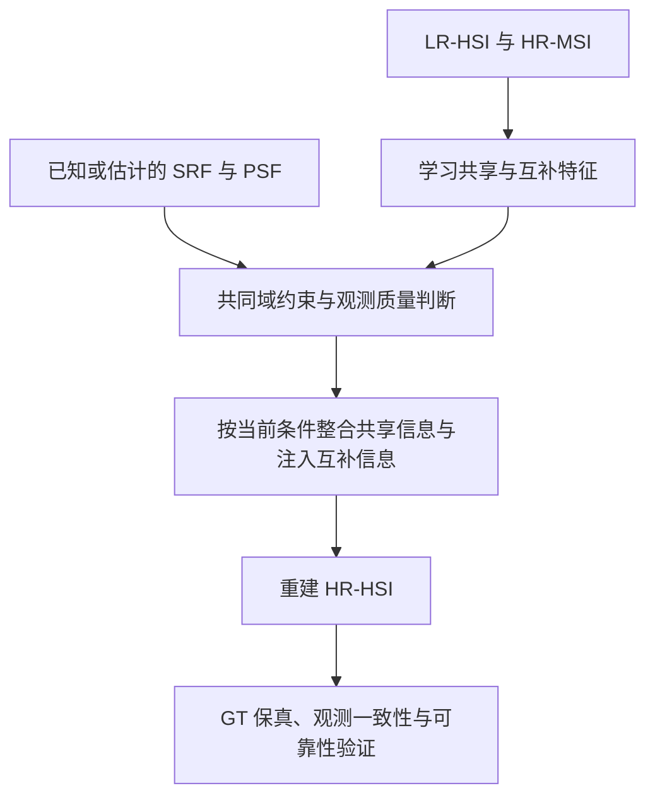

# 解耦方向的近期顶刊阅读：从“特征分开”到“观测支持与可靠融合”

阅读日期：2026-10-12。面向第一次接触这些论文的研究者。研究语境来自你提供的两张组会 PPT；其中的候选网络和“Shared 过度依赖训练传感器”属于研究设想，尚不是实验结论。

**最值得推进的问题是：在传感器响应或观测质量改变时，能否让共享与互补分支保持可检验的分工，并只注入对当前重建有用、可信的补充信息。** 先验证这个问题，再决定需要什么模块。

本报告按你要求的四层组织：研究问题、方法、结果证据、课题迁移。研究问题和方法部分逐项回答你的五个问题。另附两篇已完成全文阅读的证据卡，以及检索、出版信息和全文访问记录。

## 阅读范围与术语

检索窗口为 2024-10-12 至 2026-10-12。优先关注 IJCV、TPAMI、TIP、TGRS、ISPRS JPRS、Information Fusion 的直接或可迁移工作。这里的“顶刊”按相关领域主要期刊理解，不按未经核验的影响因子排榜。共核验 19 个候选的 DOI 登记信息，精选 7 篇主读论文，另保留一篇最新跨传感器线索。这是针对性检索，不宣称覆盖整个领域。

| 术语 | 英文及大白话解释 | 本报告的使用约定 |
|---|---|---|
| LR-HSI | Low-Resolution Hyperspectral Image：空间上比较模糊，但光谱波段丰富 | 一路输入 |
| HR-MSI | High-Resolution Multispectral Image：空间清楚，但光谱波段较少 | 另一路输入 |
| HR-HSI | High-Resolution Hyperspectral Image：空间清楚、光谱也丰富 | 希望重建的结果 |
| Shared | 两路能共同支持的信息 | 不自动等于传感器无关表示 |
| Complementary | 某一路提供的补充信息 | 不自动等于全部有用，也不自动等于噪声 |
| SRF | Spectral Response Function，光谱响应函数：一个输出波段混合了哪些波长、各占多少 | 用 R 表示离散响应矩阵 |
| PSF | Point Spread Function，点扩散函数：一个点被模糊到周围的方式 | 空间退化 D 包含模糊和降采样；PSF 不是完整的 D |
| 不确定性 | 对重建或信息可靠程度的估计 | 区分观测噪声、响应估计错误、模型误差与不可辨识性 |
| SAM | Spectral Angle Mapper，光谱角指标：光谱曲线的方向是否接近 | 和 Segment Anything Model 是两个不同的 SAM；后者写全名 |

为了统一符号，采用波段×像素排列：H 是 LR-HSI，M 是 HR-MSI，X 是 HR-HSI，H≈XDᵀ，M≈RX。论文自己的符号可能相反，下面不据此改变其原始公式含义。

| 优先级 | 论文与出版信息 | 对你的帮助 | 本次阅读证据 |
|---|---|---|---|
| 1 | MossFuse：*Unsupervised Hyperspectral Image Super-Resolution via Self-Supervised Modality Decoupling*，IJCV 134，152，2026；在线 2026-03-06 | 明确原方法已解决什么、还缺什么 | 作者 arXiv v4 全文；期刊身份单独核验 |
| 2 | *Building Non-Uniform Degradation Model for Position-Aware Hyperspectral Image Fusion*，TPAMI 47(12):11464–11482，2025 | 物理约束是否贴近真实成像 | 作者摘要、仓库及训练损失；期刊全文未取得 |
| 3 | RASD-FuNet：*Rank-aware routing decomposition for hyperspectral and multispectral image fusion*，Information Fusion 136:104498，2026 | 哪些区域适合怎样的分解、路由 | 出版社摘要及作者训练代码；全文未取得 |
| 4 | CoPGNet：*Exploring structured uncertainty for external prior-guided hyperspectral image fusion*，Information Fusion 129:103997，2026 | 按区域理解难度与不确定性 | 出版社可得摘要、引言和片段；完整方法与结果表未取得 |
| 5 | VPG-Net：*Uncertainty-Driven Generative Prior Learning for Sparse Model-Guided Hyperspectral Image Fusion*，TIP 35:5224–5238，2026 | 先验的引入也需要判断可靠性 | 摘要；全文未取得 |
| 6 | BHSR-Net：*Blur-Resistant Hyperspectral Image Super-Resolution via Dual-Degradation Fusion Model*，TIP 35:8338–8353，2026 | 清楚的 MSI 仍可能含模糊、不能全盘信任 | 摘要、作者说明及训练入口；全文未取得 |
| 7 | SpecAware：*A Spectral-Content Aware Foundation Model for Unifying Multi-Sensor Learning in Hyperspectral Remote Sensing Mapping*，ISPRS JPRS 234:242–260，2026 | 怎样把传感器信息真正送入特征学习 | 作者 arXiv v2 全文；期刊身份单独核验；邻近表征任务 |

RASD 的登记卷期是 **2026 年 12 月**，晚于阅读日；其出版社摘要和作者代码已公开，因此按“当前可访问的在线论文”纳入，**不把未来卷期日期写成已经发生的发表日**。本次未核到其精确首次上线日。CoPGNet 的 DOI 含 2025，卷期是 2026；SpecAware 的预印本始于 2025，期刊卷期是 2026。不能只凭 DOI 年份或预印本年份判断期刊出版年。

全文未取得的五篇可以帮助定位研究问题，但实验层不能补写不存在的分数、消融结果或泛化结论。全文阅读的两篇包含正文、表格、图注与参考文献；未完成全部原始图像的视觉核查，具体范围见阅读账本。

## 1. MossFuse：先读懂你的研究起点

[期刊](https://doi.org/10.1007/s11263-026-02757-8) · [已读作者全文](https://arxiv.org/html/2412.04802v4) · [代码](https://github.com/dusongcheng/MossFuse)

### 第一层：它到底要解决什么问题？

1. **背景是什么？** 两台相机拍同一场景，一台看得细但颜色种类少，另一台颜色种类多但空间模糊。希望把两者结合起来。
2. **痛点是什么？** 直接混合两路特征，可能重复处理共同信息，也没有让分支清楚地承担不同任务。
3. **真正想解决什么？** 在没有 HR-HSI 真值的训练中，能否先分出两路共同部分及各自补充，再有效重建。
4. **为什么值得研究？** 好的分工可能同时改善重建质量和计算效率，也给“为什么要这样融合”一个解释。
5. **一句话概述：** 让两路图像先分清共同信息和各自补充，再通过自监督把它们组织成高分辨率光谱图像。

以上来自原文 §1、§3.1–3.3。这里“分工更清楚”是作者的设计目标，其物理意义还需要看证据。

### 第二层：方法是怎么一步步工作的？

方法是 **Modality-Decoupled Spatial-Spectral Fusion（MossFuse）**。它不是只有一个特征分离损失。

| 步骤 | 做什么 | 为什么做 |
|---|---|---|
| 1 | 上采样 HSI，分别提取两路特征 | 让它们能在相同空间尺寸下交流；上采样本身不会创造真实细节 |
| 2 | 每路分出 Shared 和 Complementary | 建立共同信息与补充信息的分工 |
| 3 | 用 Subspace Clustering Loss（子空间聚类损失）拉近两路共享特征、压低若干分支间的相似性 | 给“共享”和“互补”的命名提供训练信号 |
| 4 | 从分出的特征重建原输入，以及共同的低分辨率 MSI | 避免只把特征拉开，却把信息弄丢 |
| 5 | 估计 SRF/PSF，并要求两路退化到共同尺度后尽量一致 | 建立成像关系的约束 |
| 6 | 用空间与光谱聚合模块依次加入两种补充信息，输出 HR-HSI | 将分工后的信息重新组织起来 |

原文 §3.4–3.7、Eq.14–20 给出这些模块和损失。原作已有注意力式调制与残差通路，不能将它描述成“把全部互补信息等权相加”。

**与传统思路的区别：** 不只是增大网络，而是把“先分工、再交流、还要能够重建观测”变成结构和训练目标。

**可能的创新位置：** 对无监督 HSI–MSI 融合，把显式分支分工、分离约束、共同域重建和聚合连成一个整体。不能仅凭作者措辞认定这是所有多模态任务中的首次解耦。

### 第三层：实验怎样支持方法？

原文 Table 1 在 CAVE、Harvard、NTIRE2018 的合成设置下报告了重建结果；Table 2 是真实数据的无参考指标；Table 6 是模块消融。只看“大表第一名”不足以理解方法，消融更贴近你的问题。

例如 CAVE 的完整模型 PSNR 为 **42.15 dB**；去掉子空间聚类损失为 **37.83 dB**，去掉共同 LR-MSI 约束项为 **40.33 dB**。这支持这些训练信号在该配置下有用。去掉解耦的版本为 **38.63 dB**，但其参数量也由 0.549M 变成 0.395M，不能把差值全解释成纯粹的解耦效应。[原文 Table 6](https://arxiv.org/html/2412.04802v4)

还有两点与你直接相关：作者已经在 §4.4、Fig.10 研究了响应扰动及噪声；也用 Fig.11 的特征/PCA 展示支持分离。因此，“MossFuse 完全没有考虑物理约束或失配”不成立。**这些结果仍没有单独证明：跨传感器出错的原因就是 Shared 分支学错了。** 那需要针对分支功能的实验。

### 第四层：你能迁移什么？

把“最终图像更好”与“分支承担了正确功能”分开验证。例如，在共同域信息不变时，只改变 HSI 能支持的光谱方向，检查共享域输出是否稳定、HSI 补充分支是否响应。

还要注意：原作将两路共享特征合并后解码共同 LR-MSI。这个合并结果正确，并不单独保证每一路 Shared 都只保存共同观测信息；隐藏特征中仍可能有解码器没有使用的内容。这是可以检验的分支功能问题，不能仅凭潜变量命名判断。[原文 §3.4、Eq.16](https://arxiv.org/html/2412.04802v4)

你的 PPT 应将“数据驱动 → 加入物理约束”改成：**“已有物理一致性约束下，进一步检验并加强分支功能；让互补注入随当前观测条件变化。”** 这是课题定位建议，不是已经证实的新贡献。

## 2. NUD/PAF：物理约束首先要约束对东西

[论文](https://doi.org/10.1109/TPAMI.2025.3604234) · [作者代码与摘要](https://github.com/jeline0110/NUD_PAF)

证据范围：摘要和作者代码；以下没有推断未见的论文结果表。

### 第一层：研究问题

1. **背景：** 融合训练要知道，清楚的图像经过什么过程才变成传感器观测。
2. **痛点：** 过于简化的退化模型可能不能描述真实数据；不同位置的成像影响也可能不同。
3. **真正问题：** 能否让退化模型和融合网络都理解这种位置差异。
4. **价值：** 如果训练时用错了“相机规则”，网络即使严格遵守规则，也可能得到错误图像。
5. **一句话：** 用随位置变化的退化模型和融合方式，更贴近真实的 HSI–MSI 成像。

### 第二层：方法

**Non-Uniform Degradation（NUD，非均匀退化）** 和 **Position-Aware Fusion（PAF，位置感知融合）** 是两个配合的部分。

先建模不同位置的退化差异，再估计相应关系，然后把位置信息送进融合网络，让重建与退化方式匹配。各步骤分别解决“规则不够准确”“规则参数不清楚”“重建网络不理解局部差异”的问题。

传统的全图统一退化假设像是给所有位置用同一副眼镜；NUD/PAF 允许不同位置有不同的观测条件。其核心改变是成像假设与融合结构相互匹配，具体算子、正则项及完整创新边界仍需期刊全文。

### 第三层：证据到哪里为止？

作者仓库公开了真实 HypSen 数据、模拟辅助数据和实验入口。检查 `main_fus_real.py` 的训练段可见，三项损失以 LR-HSI、LR-HSI、HR-MSI 为目标；模拟入口也是对观测/内部降尺度目标训练。因此它不是普通的 HR-HSI 真值配对监督基线。[真实数据训练入口](https://github.com/jeline0110/NUD_PAF/blob/main/PAF/main_fus_real.py)

这项代码证据说明它如何训练，不能替代论文的效果核验。目前不能给出完整的“非均匀模型到底提升多少”的结论。

### 第四层：迁移

先做低成本对照：固定正确响应、轻微响应错误、局部退化变化。在这些条件下比较普通物理损失与按区域处理的版本。若收益完全来自更准确的退化估计，就将贡献落在退化建模；若退化固定正确后，分支功能约束仍有独立收益，才支持解耦方向。

**学到的关键：物理约束的可信程度，取决于你是否正确描述了观测过程。** 非均匀退化是已有研究，不能将“区域物理约束”本身声称为空白。

## 3. RASD-FuNet：不宜给所有位置同一种分解方式

[论文](https://doi.org/10.1016/j.inffus.2026.104498) · [出版社摘要](https://www.sciencedirect.com/science/article/pii/S1566253526003775) · [代码](https://github.com/YuanyeLiu/Rank-Aware-Routing-Decomposition-for-Hyperspectral-and-Multispectral-Image-Fusion)

证据范围：摘要和作者训练代码；准确上线日与完整实验表未取得。

### 第一层：研究问题

1. **背景：** 一片比较单一的区域，许多光谱可以用少量基本模式表示。
2. **痛点：** 材料混杂、结构复杂的区域可能不适合相同的简化表示；全图统一分解可能损失信息。
3. **真正问题：** 网络能否决定哪些位置适合简单分解、哪些需要更强的处理。
4. **价值：** 在合适位置节省计算，在困难位置保留表达能力。
5. **一句话：** 根据局部信息能否被简单表示，为不同位置选择不同处理分支。

这里的 **Low-Rank（低秩）** 可以先理解为“很多通道的变化，能由少数几种基本变化组合出来”。它与 Shared/Complementary 是不同的划分依据。

### 第二层：方法

**Rank-Aware Selective Decomposition（RASD，按低秩适用程度选择分解）** 是核心。

先由可学习判别器估计特征点的低秩适用程度；适合简化的位置送到轻量分解分支，其他位置送到表达能力更强的注意力分支；复杂分支结合光谱注意力、Mamba 的长距离信息处理和局部梯度，最后串联多个模块重建图像。它们分别解决“该怎样分工”“简单位置的效率”“复杂位置的表达”“路由可能丢掉局部连续信息”的问题。

与全图统一低秩分解相比，它改变了分解适用范围。可能的创新在于“根据局部条件选择分解及补偿路由副作用”，不是只添加一个门控层。

### 第三层：证据

摘要报告重建效果和 FLOPs 优势，但本次没有结果表，不能写出提升幅度。作者 `train_cave.py` 以 `L1Loss(fusion, gt)` 训练，确认该入口使用真值监督。[训练代码](https://github.com/YuanyeLiu/Rank-Aware-Routing-Decomposition-for-Hyperspectral-and-Multispectral-Image-Fusion/blob/main/train_cave.py)

**分解适用程度高，不意味着传感器信息可靠。** 两者的训练目标与含义不同，不能直接拿这个分数当作你的物理置信度。

### 第四层：迁移

它支持你研究“有条件的处理与信息使用”。但你的门控应回答：**某一路补充信息是否能改善当前重建**，而不是简单照搬“这里是否低秩”。

比较普通注意力门控、等比例随机门控、仅局部结构门控和传感器条件门控；保持参数和训练预算相近。若普通门控就解释了全部收益，物理条件没有增加价值，就不支持你希望建立的故事。

## 4. CoPGNet：困难区域在训练时可能应该多受关注

[论文](https://doi.org/10.1016/j.inffus.2025.103997) · [出版社可得材料](https://www.sciencedirect.com/science/article/abs/pii/S1566253525010590)

证据范围：摘要、引言及出版社片段。未取得完整损失公式、实验表和消融。

### 第一层：研究问题

1. **背景：** 严重退化之后，输入里的细节可能已经少到不够用。
2. **痛点：** 单靠退化输入学习重建可能受限；错误也可能集中在某些材料区域，而非均匀分布。
3. **真正问题：** 能否结合干净数据学到的先验，并在训练中更关注结构相关的困难区域。
4. **价值：** 平均误差下降时，某类材料的光谱仍可能恢复不好；按区域看问题可以发现这种掩盖。
5. **一句话：** 用外部干净知识和内部结构信息辅助重建，再针对困难区域调整训练关注程度。

### 第二层：方法

**Collaborative Priors-Guided Network（CoPGNet，协同先验引导网络）** 联合两类先验：外部先验来自干净 HSI；内部先验来自当前输入及其结构联系。随后通过结构调制增强区域联系，并借助 **Segment Anything Model（通用图像分割模型）** 的区域信息学习结构不确定性，再提高困难区域的训练权重。

各步骤分别补充“输入缺失的经验知识”“当前场景的结构”“区域内部的一致性”“训练资源的分配”。与逐像素等权损失相比，它按结构组织误差。可能的创新位置是先验协同及结构化训练机制。

### 第三层：证据

公开材料描述了 CAVE、Harvard 的融合实验，并另有 NTIRE2022 的光谱超分实验。后者不能混成相同的 HSI–MSI 双输入融合成绩。本次没有完整表格，因此不将作者报告的总体优势写成已经独立核验的效果或校准证据。

引言对 MSE/L1 的讨论可以理解为：等权损失没有显式表达位置相关的噪声/误差尺度；这不意味着使用 MSE/L1 在数学上必然强迫实际误差分布均匀。

### 第四层：迁移

最值得借鉴的是**区域级分析**。你可以在有监督数据上检查：边界、稀少材料、光谱变化复杂区域，是否有不同的误差和门控需求。

不要直接把 CoPGNet 的不确定性变成“越不确定、融合时注入越少”。其公开描述强调困难区域训练时加权；你的目标可能是降低不可靠输入的注入。一个调节学习关注，一个调节信息信任，方向可能不同。

Segment Anything Model 的语义区域也不自动等于同一光谱材料。迁移时需检查区域内光谱差异，并和不依赖分割模型的局部区域对照比较。

## 5. VPG-Net：学到的“干净知识”也可能选错

[论文](https://doi.org/10.1109/TIP.2026.3689415) · [摘要](https://pubmed.ncbi.nlm.nih.gov/42133515/)

证据范围：摘要。没有读取正文公式、具体训练阶段或消融表。

### 第一层：研究问题

1. **背景：** 从退化图像恢复细节，除了当前测量，还可以参考干净图像的常见规律。
2. **痛点：** 只从退化—干净配对学习的先验可能受训练退化限制；遇到严重或未见退化容易失效。
3. **真正问题：** 能否引入从干净 HSI 独立学习的先验，同时可靠地匹配当前输入。
4. **价值：** 先验能补足有限观测，也可能把不适合当前材料的内容带进来，匹配是否可靠很关键。
5. **一句话：** 建立干净 HSI 的特征模板库，再结合不确定性把当前退化特征与合适模板连接起来。

### 第二层：方法

**Vector-Quantized Prior-Guided Network（VPG-Net，离散模板先验引导网络）** 将稀疏模型的 **Maximum A Posteriori（MAP，综合观测和先验选择重建）** 求解步骤展开为可训练网络。

摘要支持以下流程：先在干净 HR-HSI 上学习编码器和 **Codebook（离散特征模板库）**；再用不确定性驱动的概率匹配连接退化特征与模板；最后把匹配到的先验作为动态调制信息加入重建。稀疏模型用于增强噪声抵抗，模板用于提供干净先验，概率匹配用于减少错误对应造成的伪影。

它与直接把最近模板硬塞进网络的区别，在于匹配过程中考虑不确定程度。完整公式和实际训练细节目前不可评估。

### 第三层：证据

摘要报告了干净、退化、模拟和真实数据实验，但本次不能核验各设置、分数、消融、预训练数据隔离或不确定性校准。因此该论文可以作为重要先例，暂不能作为“已证明可靠互补选择有效”的证据。

### 第四层：迁移

你的互补特征和外部先验虽不同，都有“是否适合当前重建”的判断问题。可以先研究小型互补注入头，加入响应信息与留出验证，而不必立即复现完整模板库。

需要分别测试：匹配分数是否预测错误、门控是否改善最终结果。一个分数与误差有关，不代表把它放进融合后一定有效。外部干净 HSI 带来额外数据成本，对照必须清楚记录。

## 6. BHSR-Net：MSI 的细节也有成像质量限制

[论文](https://doi.org/10.1109/TIP.2026.3714832) · [摘要](https://pubmed.ncbi.nlm.nih.gov/42497040/) · [代码](https://github.com/Dou0405/BHSR-Net)

证据范围：摘要、作者说明与训练入口；完整正文和实验表未取得。

### 第一层：研究问题

1. **背景：** HSI–MSI 融合常把 HR-MSI 当成空间细节来源。
2. **痛点：** HR 表示采样更密，并不保证完全无模糊；理想模型可能忽略 MSI 的模糊。
3. **真正问题：** 能否把两路的退化一起写进重建模型。
4. **价值：** 若直接把模糊 MSI 当成可靠细节，网络可能无法正确恢复精细结构。
5. **一句话：** 同时考虑 HSI 的空间退化与 MSI 的模糊，让融合模型理解两路观测都不完美。

### 第二层：方法

先建立 **Dual-Degradation Fusion（双退化融合，D²-Fusion）** 模型；用 **Semismooth Newton（半光滑牛顿法，利用局部变化信息逐步纠正估计）** 求解；再把这些步骤变成端到端可训练的 **BHSR-Net**。

三个步骤分别回答“相机如何产生观测”“怎样恢复潜在图像”“怎样用数据学习求解中的先验与参数”。其区别在于改写观测模型，并让网络结构对应求解过程。具体迭代式、已知/估计的模糊参数及期刊实验条件仍需正文核验。

### 第三层：证据

摘要报告五个数据集及轻量版约 38K 参数。这是作者的摘要声明，不能据此推算你项目的运行时间或复杂失配下的结果。公开训练入口将 `pred` 与 `HrHSI` 一起送入损失，确认存在 HR-HSI 真值监督。[训练入口](https://github.com/Dou0405/BHSR-Net/blob/main/train.py)

### 第四层：迁移

先只改变 MSI 模糊程度，保持 HSI、SRF、配准和场景不变。看原模型是否把不可信的空间补充带入输出，再比较已知模糊条件与估计条件。

它帮你得到一个具体动机：“互补信息的空间清晰度受观测条件限制”。但如果这已经由正确双退化模型解决，增加门控未必有独立价值；应把 BHSR 式模型对照纳入比较。

## 7. SpecAware：让网络知道波段的物理含义

[期刊](https://doi.org/10.1016/j.isprsjprs.2026.02.024) · [已读作者全文](https://arxiv.org/html/2510.27219v2) · [代码](https://github.com/busbyjrj/SpecAware)

### 第一层：研究问题

1. **背景：** 不同高光谱相机的波段数量、中心波长、带宽和空间分辨率不同。
2. **痛点：** 固定输入层按“第几通道”处理数据，同一通道序号换相机后可能意味着不同的波长范围。
3. **真正问题：** 一个模型能否理解传感器信息，并处理可变波段配置。
4. **价值：** 避免每换一种数据就重建输入结构，也为多传感器学习提供依据。
5. **一句话：** 把“相机测什么”和“当前图像是什么”一起用于生成特征编码方式。

它研究的是光谱图像表征及分类、分割、变化检测，**不是双输入 HR-HSI 融合重建论文**。迁移需要重新验证。

### 第二层：方法

| 步骤 | 原词与通俗解释 | 解决的问题 |
|---|---|---|
| 1 | 编码 wavelength、FWHM、传感器及数据级别 | 让模型知道波段含义和成像来源 |
| 2 | 从当前图像提取简单内容统计 | 相同传感器拍不同场景，也需要不同处理 |
| 3 | Hypernetwork（生成另一部分网络权重的小网络）联合条件信息 | 让编码方式随输入条件调整 |
| 4 | HyperEmbedding（动态逐波段编码），生成两组矩阵因子再聚合 | 处理可变数量的波段，输出统一宽度特征 |
| 5 | 动态解码与 Masked Image Modeling（遮住部分内容再预测）预训练 | 在没有语义标签的大量 HSI 上学习 |
| 6 | 接下游任务头并适配 | 检验特征是否有用 |

步骤来自 §4.2–4.7。它与仅把波长拼到固定网络不同：条件信息参与编码和解码权重的生成。可能的创新位置是逐样本、逐波段的动态结构和多传感器学习方式，不是波长编码这个概念本身。

### 第三层：实验与边界

原文 Table 11 的受控预训练/线性探测消融中，仅波长条件的 OA 为 **80.09%**；波长加 FWHM 为 **82.01%**；完整条件为 **83.15%**。FWHM 是 **Full Width at Half Maximum（半高全宽，响应曲线主要覆盖的宽度）**。这些结果支持带宽等条件信息在该表征任务中有用。[作者全文 Table 11](https://arxiv.org/html/2510.27219v2)

完整条件相对仅波长增加的不止一个因素，不能把全部差值都归给 FWHM。这里的 83.15% 也不能与不同训练预算下 Table 8 的最终模型成绩拼起来解释。

作者使用下游微调或线性探测；“无需修改网络结构”不等于“不需要目标域训练”。分类/分割好，也不等于重建的每个波段数值保真。

### 第四层：迁移

先在你的小型融合网络中做四个前端对照：无条件、仅中心波长、波长加 FWHM、完整 SRF。比较同样场景和未见传感器条件下的重建。

中心波长和 FWHM 不能完全决定响应曲线：两条曲线可能中心和宽度相近，但形状不同。这为“完整响应条件是否有额外价值”提供了具体问题；并不自动构成新颖性。

原文的学习规模很大，初步迁移优先采用小型条件模块。保留 GT 辐射值监督，不能只优化光谱角，否则曲线方向正确而幅值仍可能错误。

## 8. 最新补充：直接关注跨传感器重建

*Interpretable Cross-Sensor Hyperspectral Image Super-Resolution*，TGRS 64，5527116，2026，IEEE 页面给出在线日期 **2026-08-26**。[正式页面](https://ieeexplore.ieee.org/abstract/document/11667122) · [DOI](https://doi.org/10.1109/TGRS.2026.3727427)

这篇非常贴近“换传感器后是否可靠”，但目前仅取得摘要，不能把它写成已精读论文。

**问题层：** 背景是源传感器训练与目标传感器应用之间的差异；痛点是迁移性和可解释性不足；真正问题是能否使用可迁移的材料光谱先验支持新传感器；价值在于降低重新训练的需要；一句话是“用显式光谱先验帮助跨传感器超分辨率”。

**方法层：** 摘要提出端元感知动态调制 EDMN，把材料相关信息变成逐波段权重；再加入局部光谱平滑与空间梯度约束 LSSSC，并与展开网络结合。它们分别服务于先验迁移与保谱/保边界。具体输入是否包含 MSI、如何建立源—目标协议、训练标签与响应条件，本次未由全文确认，不能当作已核验的直接融合基线。

**证据层：** 作者报告三个数据集的跨传感器实验及下游分类验证；缺少表格、训练划分和预训练数据记录，无法核验效果幅度与无重训协议。

**迁移层：** 你的工作必须与“材料先验迁移”“普通传感器条件化”等解释区分。跨传感器本身不是空白。只有证明分支功能和可靠注入带来独立贡献，故事才进一步清楚。

## 9. 怎样把这些论文合成你的研究思路

### 先修正 PPT 中的三个判断

**第一，MossFuse 已有物理约束。** 原文 Eq.16、18、19 分别约束共同 LR-MSI、退化一致性和最终输出。你的新增点要落在分支功能或条件化注入，并与已有约束区别开。

**第二，MossFuse 已有响应失配实验。** 你更合适的待验证假设是：“现有损失是否足以让分支在未见传感器条件下保持功能；观察到的性能变化由分支分工、响应估计还是其他因素导致。”

**第三，共同信息会随传感器组合变化。** 换 SRF 后，两路共同支持的光谱方向可能改变；要求 Shared 永远完全不变，并不一定符合物理。先定义你希望保持的是共同域预测、材料因素，还是某个标准光谱表示。

### 用一个小例子理解“物理可观测性”

假设某个 MSI 波段只测两个 HSI 波段的平均值。两个波段从 `(1, 3)` 变成 `(2, 2)`，平均值都为 2，MSI 无法区分；HSI 在它实际采样的空间尺度上可以区分。

这个例子说明：有些光谱变化应由 HSI 的补充信息负责，不能强迫 MSI 的共享表示解释它。它没有说明 HSI 能唯一恢复所有 HR 像素的细节。

在前述线性、配准、空间退化对各波段相同的理想条件下，两路都退化到同一尺度后有：

\[
RH \approx MD^\top.
\]

这是共同观测关系。**隐藏特征看起来相似**和**能正确解释共同观测**是不同的证据。若存在局部波段相关退化、错配或照明差异，这个简化关系也需修改。

还可能有两台相机都看不到的变化 ΔX，使 RΔX=0 且 ΔXDᵀ=0。观测一致性无法分辨 X 与 X+ΔX；GT 监督和先验才可能提供额外信息。物理一致性因此不能替代保真评估。

### 一个更清楚的候选流程

这是一张研究候选流程图，不是文献里已验证的网络，也没有据此认定新颖性。不确定性最好先选一个具体对象，例如“MSI 空间补充对当前重建的误差尺度”，避免一个头同时承担四种含义。

### 最先做的四组实验

下面是根据文献与 PPT 提出的实验建议，**未实施、没有结果**。

| 实验 | 控制变量与比较 | 看什么 | 怎样解释 |
|---|---|---|---|
| 1. 动机 | 相同 HR 场景，改变合法 SRF/PSF；传感器 A 训练、B 测试；同波段数量起步 | PSNR、SAM、波段误差及共同域预测 | 若没有稳定失配现象，弱化“换传感器导致分工失效”的主故事 |
| 2. 归因 | 测试时分别给正确算子、受控错误算子、估计算子；模型权重及测试输入相同 | 退化参数误差与最终重建误差 | 正确算子已解决大部分问题，优先做退化估计；仍出错才进一步检查分工 |
| 3. 分工 | 基线已有约束、增加普通辅助头、增加有物理角色的约束；匹配参数与更新次数 | 哪种输入变化由哪个输出贡献解释；最终重建是否同步受益 | 只有辅助头正确、主重建未变好，说明探针可能是旁路，不能证明主体解耦成功 |
| 4. 选择性注入 | 普通注意力、随机/常数门控、仅残差门控、传感器条件门控 | 最终保真、困难材料、门控与错误关系及校准 | 普通门控或响应增强已达到同样结果，物理门控的独立贡献不足 |

先把场景与传感器两轴分开：相同场景的新响应用于机制诊断，独立场景与留出传感器用于最终泛化。主测试不能让同一 HR 场景以另一响应形式进入训练。目标域无适配与有适配分别报告；真值响应属于较强条件，不能和未知响应直接混排。

原始 Shared 向量可以发生可逆旋转，因此不宜只比较向量距离判断物理正确性。优先看在统一物理坐标中的解码结果、合理干预下的响应，以及它们对最终重建的作用。

对不确定性，在独立验证集上检验预测尺度与真实误差的关系；如果输出概率或区间，就检查负对数似然、覆盖率与区间宽度。仅画一张“亮处刚好像误差”的图不够。没有 GT 的真实数据中，观测残差只能验证观测域的一致性，不能替代 HR-HSI 误差真值。

## 10. 推荐的实际阅读顺序

先读 MossFuse 的 §3.1、§3.5、§3.7、Table 6 与失配实验，划清基线边界；接着读 NUD/PAF 的观测假设和公开训练方式；再看 RASD-FuNet 与 CoPGNet，建立局部条件、训练关注及输入信任的区别；随后看 BHSR-Net 的双退化假设、VPG-Net 的先验匹配；最后读 SpecAware 的条件编码及 Table 11。最新跨传感器论文优先用于补查直接近邻。

**建议你当前的主研究句子：在已有成像一致性约束下，研究未见传感器条件中的分支功能与互补注入可靠性，并通过受控响应变化和预算匹配对照判断它们是否改善光谱保真。**

这句话现在是一项可以验证的研究问题。文献尚未替你证明动机成立，也未证明这个组合具有发表级新颖性。
