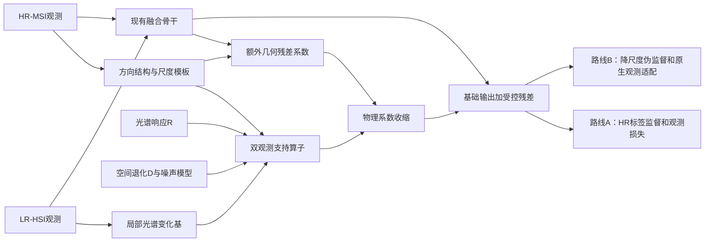

# 局部光谱可辨性约束的方向几何条件注入：深入研究方案

研究时间：2026-10-07。对象：LR-HSI 与 HR-MSI 融合。用户选择：有监督与无 HR-HSI 真值两条路线同等展开。本文件是研究方案与证据分析，不是已验证的方法论文；未训练候选网络。

## 判断与推荐

这个方向值得做一个有退出条件的研究项目，但需要比最初的“几何＋局部光谱门控”更窄、更准确。几何引导、方向约束、局部低秩、响应投影、条件注入和学习门控都已有先例。最有希望的研究问题是：**一条 MSI 边界带来的细节，应当分配到哪些局部光谱—空间变化模式？两类观测分别能支持多少？**

推荐工作名：**双观测支持度约束的局部光谱—方向几何注入**。保留原 idea 的光谱可辨性主线，但把“MSI 能不能分辨”升级为“MSI 光谱响应与 HSI 空间退化联合能不能稳定支持”。英文暂名：*Joint-Observation-Supported Directional Geometry Injection for Hyperspectral–Multispectral Fusion*。正式标题应随实验结论调整。

最初的 $RU_b$ 条件仍很有用，但它只是 MSI 通路的局部光谱灵敏度，不能独自代表整个融合问题的可辨识性。这个修正是本轮最重要的结论。推荐先研究已配准、已知退化的情形；盲退化、配准、扩散和不确定性是后续扩展，各有独立假设，不能同时包装为已解决。

创新性判断：有潜力，当前证据不足以宣称首次或保证顶刊。完整读过的文献与公开作者代码中，未确认一个与下文“局部方向模板上的联合观测支持度、作用于物理光谱残差、两条训练路线”完全同构的实现；SDP-Net 与 GGAT 完整论文仍存在访问缺口。因此只能说定位已收窄，不能说已经排除了所有已有工作。

**检索后更新：原始 $RU$＋软门控版本的新颖性不足，不能作为论文核心。** 最后一次合法检索取得[2014年局部低秩扩展报告](https://hal.science/hal-00960076v2)，已完整阅读。其方法节已经明确讨论局部响应字典 $RD_j$ 的小奇异值导致噪声放大，并使用 $(D_j^TR^TRD_j+\tau I)^{-1}D_j^TR^T$ 正则化逆解。它不是取得的正式TIP 2016全文，二者不可混称；但这个更早的明确先例已足以否定“局部响应灵敏度＋ridge”本身的新颖性。本方案需要在这个强先例之上取得可验证的额外贡献。

## 1. 动机：从边缘增强转向细节的光谱归属

HSI 提供丰富光谱，但空间模糊；MSI 提供空间细节，但通道数少。传统说法“用 MSI 补 HSI 边缘”容易忽略：MSI 的某条边缘反映的是若干窄波段经过响应函数混合后的变化。相同的 MSI 外观可能由不同的 HSI 光谱变化产生。

例如，两个材料在 RGB 中很相似，在某些窄波段差异很大；也可能 RGB 边缘很强，却并不意味着所有 HSI 波段都发生相同幅度的变化。光照、阴影和反射变化也可能产生强边缘。因此，几何主要告诉我们变化的位置和方向，不能直接确定完整光谱变化向量。只有把传感器响应和 HSI 对该变化的观测能力一起考虑，才能讨论“该往哪些光谱模式里注入”。这些例子是研究动机，当前尚未在本项目自然场景上完成统计验证。

适合构成论文中心的假设是：**几何先验的效用不仅由边缘强度决定，还由局部光谱变化方向、空间尺度、退化算子和噪声共同决定。** 潜在结果是减少边界附近的错误光谱分配，而不只是让图像更锐。

为什么局部？不同区域包含不同材料，局部光谱变化空间可能比整幅图更低维。但“局部维度不超过 MSI 通道数”不保证响应后满秩，更不保证噪声下稳定。为什么方向？相同局部光谱空间内，沿边界的缓变、跨边界的突变、细线和粗区域可能具有不同的 HSI 可观测性。方向性必须进入空间模式或传播过程，仅将角度图拼到特征上不够。

## 2. 已有研究、成果、可借鉴点与本方案差异

下表中的“限制”区分作者明确承认的限制与本方案提出的评价问题。没有做复现的工作，不声称其自然场景表现已经失败。不同论文分数、传感器和退化配置不相同，不能横向直接比较 PSNR。

| 工作与证据深度 | 已完成的内容和成果 | 对本问题的限制或未回答问题 | 借鉴后需要的改进 |
|---|---|---|---|
| [局部低秩融合，TIP 2016](https://doi.org/10.1109/TIP.2015.2496263)，正式元数据/摘要；另完整阅读[2014扩展报告](https://hal.science/hal-00960076v2) | 分块、局部谱基、响应字典与区域划分；2014报告明确分析响应字典相关性、小奇异值及噪声放大，并用ridge逆解 | 正式2016全文未取得；不能把2014算法和结果全部归到2016。局部SVD及响应正则化已有直接先例 | 必须超出经典局部ridge：检验方向尺度的联合支持在额外几何残差通路中的价值，并保留解析ridge与同信息量学习门控对照 |
| [HySure，TGRS 2015](https://doi.org/10.1109/TGRS.2014.2375320)，完整作者预印本 | 光谱子空间、双观测数据项、向量 TV、凸优化；也估计空间与光谱响应，并在模拟和真实数据上展示效果 | 子空间、边界与噪声模型需要假设；实验中的真值投影及参数选择应与本项目评价协议区别。它没有给所有高频细节唯一恢复的保证 | 借双观测建模与低维计算；将观测法矩阵限制到局部方向模式，用于额外几何残差，而不是把传统正则化重新命名 |
| [dTV，Inverse Problems 2018](https://doi.org/10.1088/1361-6420/aaaf63)，完整作者预印本 | 以高分辨率图像方向引导 HSI，并通过盲核补偿平移；真实数据展示结构改善 | 作者明确指出逐波段处理、进一步光谱耦合的空间；没有完整 HR 真值时主要依赖视觉判断。方向约束本身不强迫产生边缘 | 借“方向可以共享，强度不必共享”的思想；改为多 MSI 通道结构张量，并以局部光谱与双观测支持度限制几何通路 |
| [CLoRF，IJCV 2025](https://doi.org/10.1007/s11263-025-02540-1)，完整 arXiv v2＋作者核心训练代码 | 用空间/光谱 INR 连续低秩表示，以观测损失和 TV 自监督；证明表示的低秩和 Lipschitz 性，支持坐标查询 | 表示连续和可查询不等于恢复了任意频率的真实细节；作者承认迭代多、表示形式单一。某些数据 SAM 并非最佳 | 借观测训练、因子化与连续查询作为自监督强对照；增加方向模式支持诊断。公开代码按 HR 真值 PSNR 保存最佳结果，复现本路线时改用固定停止或合法验证，不能把此代码选择规则混入无真值协议 |
| [MossFuse，IJCV 2026](https://doi.org/10.1007/s11263-026-02757-8)，复用前一轮方法证据 | 模态分解、共享/互补信息与自监督融合及退化建模 | 不能将它描述成“没有模态交互”或“只做简单拼接”；本轮没有重做整篇阅读 | 借有物理约束的自监督设计；比较同样观测损失下，局部光谱—方向支持条件是否有额外价值 |
| [DDIF，Information Fusion 2024](https://liangjiandeng.github.io/papers/2024/zihan-infus2024.pdf)，复用既有方法证据 | 残差扩散、条件调制、空间小波细节融合 | 小波分频不能自动确定细节的窄波段归属；本方案不能宣称首次小波或残差条件融合 | 借额外残差通路和分尺度思想；先验证 CNN 上的条件价值，后续再考虑迁移到扩散 |
| [SDP-Net，KBS 2026](https://doi.org/10.1016/j.knosys.2026.116227)，出版商摘要/引言＋固定提交的作者网络与训练代码 | 小波双路径、MSI 空间注意力引导、动态门控。已有“控制细节注入”的直接先例 | 代码所核对的 SAGM 采用共享空间注意图，后面还有逐特征通道门控；不能笼统说整网只有标量门控。完整论文未取得 | 在同 backbone 上复刻强学习门控并加入响应、局部谱基、空间退化输入；检验固定物理门控是否仍胜过同信息量学习门控 |
| [GGAT，Pattern Recognition 2026](https://doi.org/10.1016/j.patcog.2026.113592)，出版商摘要/引言；完整全文缺口 | 高阶导数显式几何、跨模态图注意力、MSI 引导非局部几何恢复，还有多尺度门控 | “显式高频几何融合”已经被覆盖；是否存在同构观测条件需全文复核 | 重点比较细节的光谱分配与观测支持，而不比模块名称；以后可将支持度放进图权重或消息通路 |
| [SA-RFM，ICML 2026](https://proceedings.mlr.press/v306/zhang26df.html)，完整会议 PDF 含附录 | MSI 结构张量、各向异性度量、流匹配与方向正则，用于联合配准融合；模拟非刚性失配实验 | 是明确有 HR-HSI 的训练算法；附录实验显示 MSI 噪声、伪影、失配会降质。主文/附录的度量描述有差异，细节需对照作者代码 | 借多通道方向表征及质量退化检验；本方案研究已配准下的谱—空间细节支持，不宣称首次各向异性融合或流匹配 |

注意日期：GGAT 卷期标注 November 2026，本次检索已存在在线出版商记录；不能因为当前为 October 而排除，也不能由卷期推断首次上线日。HySure 是 **TGRS 2015**，不是 TIP；局部低秩 TIP 论文正式卷期为 2016，DOI 含 2015 不等于应标 2015 卷期。CLoRF 本地全文为 2024 年预印本 v2，正式 IJCV 2025 版本可能有修改。

最强竞争者实际由三组构成：已有几何＋门控网络；经典局部低秩＋物理观测求解；同信息量、同计算预算的学习门控。只胜过当前简单 baseline 无法支撑这个方向的独立贡献。

## 3. 核心数学问题与必须修正的定义

令 $X\in\mathbb R^{C\times N}$ 为目标，$Y=XD^T+N_H$ 为 LR-HSI，$M=RX+N_M$ 为 HR-MSI；$D$ 包含空间模糊和采样，$R$ 为 MSI 响应。$D$ 的边界、采样相位和波段是否共用核都属于模型定义。

### 3.1 原始 MSI 局部光谱支持条件

从观测 $Y$ 的局部中心化光谱或局部光谱差分估计正交基 $U_b\in\mathbb R^{C\times r}$。中心化/差分是为了关注变化方向，而不是把均值光谱误当细节。首先计算

$$RU_b=Q_b\Sigma_bV_b^T,\qquad P_b=V_b\,\operatorname{diag}\!\left(\frac{\sigma_i^2}{\sigma_i^2+\lambda}\right)V_b^T.$$

这给出 MSI 对该光谱空间的灵敏度。秩相同，最小奇异值也可能差很多。小奇异值在有噪声时带来放大风险；若无噪声、$U_b$ 已知且 $RU_b$ 满列秩，再小的非零奇异值仍不等于数学上不可辨识。软收缩属于标准正则化，不能作为新定理。

### 3.2 为什么还需要空间方向与 HSI 观测

在局部区域表示一个候选几何变化为

$$\Delta X_b=U_b A_b\Psi_b^T,$$

其中 $\Psi_b\in\mathbb R^{n_b\times k}$ 为方向与尺度相关的空间模板，$A_b\in\mathbb R^{r\times k}$ 为系数。固定 $U_b,\Psi_b$，按列向量化 $A_b$ 得到两个观测矩阵

$$\mathcal A_{H,b}=(D\Psi_b)\otimes U_b,\qquad \mathcal A_{M,b}=\Psi_b\otimes(RU_b).$$

空间模板应在完整支持域上施加 $D$，包括核跨窗口所需 halo；不能随意把全图退化换成不等价的 patch 算子。实际 overlapping patches 的外部耦合使这里成为条件于局部模型的近似诊断，不是全局证书。

以实际噪声协方差或声明的近似权重构造

$$H_b=\mathcal A_{H,b}^TW_H\mathcal A_{H,b}+\mathcal A_{M,b}^TW_M\mathcal A_{M,b}.$$

这是标准受限观测法矩阵。正交、归一化的表示与固定单位非常重要：任意缩放 $U,\Psi$ 会改变数值而不改变物理变化。如果模板非正交，使用显式物理能量度量或先正交化，并同步变换系数和正则项。若噪声未知，应报告等权版、估计版与噪声估计扰动的区别。

对单一单位空间模板 $\phi$、空间独立且谱协方差已知的噪声，条件可简化为

$$H_{b,\phi}=\|D\phi\|^2 U_b^T\Sigma_H^{-1}U_b+\|\phi\|^2 U_b^TR^T\Sigma_M^{-1}RU_b.$$

所以：粗变化即使在 $R$ 零空间中，HSI 仍可能支持；被 $D$ 丢失的细变化依赖 MSI 光谱响应；同时落在两类观测零空间的变化不能从观测唯一确定。后者可由训练先验选择，但应如实叫先验预测。

可以定义 $G_b=(H_b+\lambda I)^{-1}H_b$，作用于额外几何通路的系数。它是正半定、特征值在 $[0,1]$ 的收缩算子；不是准确率概率、不是校准后的置信度，也不是“$G$ 大就保证恢复正确”。在基固定、线性模型正确的条件下，$\ker H=\ker\mathcal A_H\cap\ker\mathcal A_M$ 是直接线性代数事实，不能包装成首次融合可辨识性定理。

**一个对新颖性很不利、必须正视的简化：** 若 $U$ 正交、HSI噪声各向同性且只使用一个空间模板，那么 $H_{b,\phi}$ 就是一个标量乘 $I$ 加一个标量乘 $U^TR^TRU$。它与 $RU$ 光谱分析共享特征向量，新增内容可能仅是按空间尺度调整收缩强度。在当前各向同性 Gaussian 模糊下，方向效应也可能主要来自采样格、边界和模板几何，而不是额外的各向异性传感器物理。因此，必须对比“按尺度调节的普通 ridge”，并检查固定带宽后方向信息是否仍有效。若没有超出该对照的增量，应该将方案收缩为有效但有限的正则化改进，不能讲成新的几何可辨识理论。

### 3.3 已完成的轻量验证

使用项目实际 $R$、8×8 Gaussian 核、对称边界、采样相位 0 构造人工模式，结果见 `joint-support-probe.json`。单位模板、等权观测、$\lambda=0.001$ 的例子：

| 模式 | HSI 观测能量 | MSI 观测能量 | MSI-only 收缩 | 联合收缩 |
|---|---:|---:|---:|---:|
| 粗空间＋MSI 可见光谱 | 0.015625 | 0.104098 | 0.990485 | 0.991717 |
| 粗空间＋MSI 零空间光谱 | 0.015625 | 约 0 | 约 0 | 0.939850 |
| HSI 空间零模式＋MSI 可见光谱 | 约 0 | 0.104098 | 0.990485 | 0.990485 |
| 两类零模式组合 | 约 0 | 约 0 | 约 0 | 约 0 |

这是定义反例，不是网络指标；数值取决于模板归一化与正则参数。谱基旋转后的物理算子一致性误差约 $1.6\times10^{-14}$。不能由此声称自然材料已有这些模式或融合性能提升。

## 4. 可落地的最小方法

### 4.1 几何表征

用多通道 MSI 梯度形成 $J_b=K_\rho*\sum_j w_j\nabla M_j\nabla M_j^T$。优先编码 $J_{xx},J_{xy},J_{yy}$、能量和 coherence，避免单独角度图的符号和周期跳变。谱通道权重 $w_j$ 依噪声归一化或固定，不能把高噪声强梯度当清晰结构。

主特征向量是梯度的法向；切向与其正交。跨边界变化通常沿法向，沿边界传播通常沿切向，不能混称。平坦区和角点在特征值接近时方向不稳定，应降低方向约束或保留各向同性模板。结构张量、多尺度和这些稳定化本身均有既有依据。

最小模板库先用固定尺度的局部方向导数 Gaussian/条带变化模板，配合切向缓变模板；方向由 $J$ 选择，带宽仅 2–3 个。每个模板明确采样域、归一化和核边界。第一版固定模板比端到端自由生成更易解释；自由模板可能通过尺度缩放或选择观测强模式操纵门控，后续才研究。

### 4.2 局部光谱空间

从 LR-HSI 观测窗口做中心化 SVD，或者从水平/垂直/邻域光谱差分做 SVD，二者必须对照。先固定 $r\in\{2,3,4\}$，不强行设 $r\leq m$。RGB 三通道下，$r>3$ 有零方向是正常的，是否可由 HSI 空间观测支持另行判断。

窗口不能过小：当前 HR patch64×64、倍率8，LR patch只有8×8。3×3 LR窗口可能样本不足；先用5×5及7×7并报告有效样本数和局部混合程度。跨材料边界的窗口易把不同子空间混合，后续才考虑区域自适应。

估计谱基的稳定性 $\beta_b$ 可通过观测扰动/重采样下的子空间主角度得到。它仅表示估计稳定，不能证明 LR-HSI 包含所有 HR 稀有材料。不能使用 HR 真值构造 $U$、局部秩、$\beta$ 或门控。HR oracle 基只允许出现在明确标注的评价上界实验中。

### 4.3 注入位置和路径

当前项目 `Net` 是两路浅特征、concat 融合、8 个残差块和31波段输出，加 bilinear HSI 残差。建议先在尾部加一个可独立消融的几何残差头：

$$\hat X=X_0+\operatorname{OverlapAdd}_b\!\left[\alpha_b\beta_b\,U_b\operatorname{reshape}(G_b a_{\theta,b})\Psi_b^T\right].$$

$a_{\theta,b}$ 由 baseline 特征与几何条件预测；$\alpha_b$ 表示方向稳定性；OverlapAdd 用归一化平滑权重处理块缝。$G$ 在物理光谱—空间模式上作用，不能把64维特征通道解释成31维光谱方向。

图中HR标签没有进入条件生成；路线B的降尺度目标也不进入该样本的谱基或支持算子估计。

保留 $X_0$ 和子空间外的基础恢复能力。弱观测模式不能被整个网络直接置零；尤其粗空间的 MSI 零方向还可能由 HSI 支持。基线本来就接收 MSI，因此这个结构只约束**新增几何残差**；不能声称控制了全网所有 MSI 信息。全通路控制是另一个架构变体，需要单独实验证据。

第一版用固定物理 $G$。第二版可让一个低容量网络预测正则强度或有限范围修正，但要限制正值、保留消融，并阻止通过拟合 GT 门控形成条件泄漏。把 $H$ 或其不变统计直接输入同信息量学习门控是必要强对照。如果学习门控已经足够，固定投影形式不是必需贡献。

## 5. 两条路线同等展开

### 路线 A：有监督，验证细节归属是否正确

输入只含 $Y,M,R,D$ 和由观测得到的 $J,U,H$。HR-HSI $X$ 仅是训练标签和独立评价真值。先保留当前 L1；必要时加入稳定 SAM 和双观测数据项，但所有关键对照共享同样的损失。

$$\mathcal L_{sup}=\|\hat X-X\|_1+\eta_{SAM}\mathcal L_{SAM}+\eta_{obs}\left(\|\hat XD^T-Y\|_{W_H}^2+\|R\hat X-M\|_{W_M}^2\right).$$

SAM 在低强度/零光谱处需固定 epsilon 与掩码，避免数值主导。不要一开始加六七种正则；先回答条件是否有用，再逐个增加。

核心评价是场景级 PSNR/SAM、固定边界区 SAM、窄波段梯度误差、不同支持度模式中的误差与收益。边界由公开固定规则建立，评价可利用 GT，但不能喂给模型。mode error 用观测基与模板投影；同时报告完整空间/光谱误差，避免投影指标隐藏子空间外错误。结构尖锐而 SAM 变坏，属于失败。

当前 CAVE 无噪声、已知退化，是完整流程的起点，不一定是最能体现稳定性价值的 setting。先保留理想 setting，允许伪逆/学习门控胜出；再加入预先规定的噪声强度、PSF/SRF扰动和罕见细结构。这些困难不能在看完结果后才选择。

### 路线 B：无 HR-HSI 真值，验证学习合法性与可观测范围

共同方法不变，改变训练证据。主训练项是

$$\mathcal L_{obs}=\|\hat XD^T-Y\|_{W_H}^2+\|R\hat X-M\|_{W_M}^2.$$

它能约束观测可见部分，不能证明观测零空间恢复正确。几何一致性若也来自同一 MSI，会形成自我确认：把 MSI 的错误边缘复制进去可能反而降低损失。因此不能以“观测误差低＋RGB好看”作为完整高光谱准确性的证据。

**B1：观测内的降尺度伪监督。** 在相同线性、波段共用空间算子假设下，$DM\approx RY$。把实际 $Y$ 当较粗尺度目标，构造 $Y'=YD'^T$ 与 $M'=MD^T$，让网络从 $(Y',M')$ 重建 $Y$。此时谱基、几何与支持条件只能从 $Y',M'$ 计算，不能从目标 $Y$ 计算。新的 $D'$ 与目标网格一致；重复退化会改变核与噪声相关性，应明确定义。若 $DM=RY$ 理想成立，则它提供相容的低尺度训练对，但不提供原生 HR 的隐藏真值。可在若干倍率联合训练，检验尺度迁移；不是天然保证泛化。

**B2：原生尺度观测适配。** 用 B1 初始化再以原生观测损失适配，或者从固定初始化直接逐场景拟合。分别对比同样适配预算的 baseline、CLoRF 和物理求解器。对于全数据训练的网络与逐场景优化，分别报告离线训练、每景适配、推理耗时，避免比较口径失衡。

无真值 checkpoint 使用预先固定迭代数，或严格未输入模型的观测验证。留出 MSI 通道/像素时，必须同时从几何、局部条件、损失和预处理里移除它，响应矩阵也使用对应子集；仅在损失里 mask 而几何仍读取完整 MSI 属于泄漏。留出 HSI 时谱基估计同样需要 mask。留出观测只能检验预测这些观测的能力，不能消除零空间不确定性。

**评价的两层证据。** 在合成 benchmark 上，算法全程隐藏 HR 真值，冻结后由 evaluator 算 PSNR/SAM；这是检验无真值训练实际精度的关键。真实原生数据没有 HR 真值，报告观测残差、合法留出预测、跨尺度一致性、伪影和敏感性；不宣称这些指标证实真实窄波段细节完全正确。两层缺一不可。

对两个路线采用相同几何头、相同信息约束和同一机制消融表。无真值路线不只是删掉 L1，也不应该只写一段 future work。它有独立训练协议、强对照、checkpoint规则和验证边界。

## 6. 最主要创新点和贡献点应如何写

**候选创新 1，研究视角：** 从“共享几何”转向“几何细节的局部光谱—空间支持”。需要自然图像统计或受控场景证据证明边缘强度不足以解释失败，且联合支持度优于局部秩、$RU$ 条件数及普通纹理统计。这是待验证的机制主张。

**候选创新 2，方法：** 将支持度算子作用于新增方向几何残差的物理系数，结合方向稳定性和谱基稳定性；保留基础与子空间外恢复。这与已有几何网络的区别必须由同信息量学习门控、普通ridge、局部低秩方向正则和 $RU$-only 变体来验证。数学收缩公式本身不算新贡献。

**候选贡献 3，验证协议：** 建立谱—空间模式级、边界光谱归属和双路线无泄漏评价，展示什么时候有利、什么时候不足。若没有新的可复用数据或协议突破，宜称系统证据贡献，避免凑成第三个“首创模块”。

可以保留以下三个条件性论文贡献句，实验完成前用“拟”：(1) 分析方向几何细节在双观测下的局部支持及失稳范围；(2) 提出基于该支持度的物理残差注入模块；(3) 在有监督和无 HR 真值训练中，通过强对照与受控退化检验其谱—空间收益与失败边界。不得写“突破不可辨识性”“保证不产生幻觉”“普遍提升所有方法”。

## 7. 怎么把论文故事讲好

开篇第一幅图固定两类例子：几何相近但谱响应支持不同；谱空间相同但空间尺度不同。展示 baseline 同样增强后产生不同的窄波段错误。现在还没有这些自然例子，必须从事先确定的案例规则抽取，并同时展示对照胜出的例子。不能只挑误差图最漂亮的一块。

引言四段的逻辑：成像权衡与融合任务；已有几何/条件方法的价值；指出边界位置与光谱变化归属不是同一问题；提出双观测支持的具体问题、方法和证据路线。Related Work 分几何条件、局部表示与观测模型、自监督证据三支，明确承认最近几何门控方法。

方法先定义何为可观测，再定义条件及作用位置，最后给两种训练目标。不要先铺 CNN/Mamba/小波模块，后面再勉强补物理动机。结构图应把“观测生成条件”和“GT仅监督/评价”画成明确不同的箭头。

实验顺序：非空反例→自然数据机制诊断→同 backbone 消融→强方法比较→无真值训练→退化与失败边界。主表只给整体指标不够；核心图是支持度分组下的几何收益/伤害，以及跨边界真实光谱曲线。预期如果成立，低支持且噪声大时额外几何的伤害减少，高支持时保留细节；这只是预期，要允许反向结果。

研究阶段的一句话叙事：**我们关心 MSI 的清晰结构应如何转化为有观测依据的窄波段细节，并检验局部光谱与方向尺度的联合支持能否帮助网络完成这种分配。** 结果出来以后，再替换“检验能否”为有具体场景和幅度限定的结论。

## 8. 决定性实验与停止条件

控制核心实验为五块，避免只堆数据和模块。详见同目录 `experiment-plan.md` 与机器可读记录。

| 块 | 两条路线中的作用 | 主要反对意见 | 继续条件 / 失败处置 |
|---|---|---|---|
| B1 数学与实现 preflight | 共用，当前仅算子反例完成 | 支持度定义只是 MSI rank 重述；算子相位不对 | exact算子、尺寸、单位、基旋转验证；本轮反例成立，但不等于性能主张成立 |
| B2 自然数据机制诊断 | 两路线均在冻结 evaluator 上分析 | 人工反例在自然场景没发生；只是边缘强度或噪声 | 支持统计能提供超出纹理/秩的解释；若不能，收缩机制主张，不继续包装理论故事 |
| B3 同 backbone 消融 | 分别训练 supervised 与 GT-hidden，3 seeds | 增参数、加物理损失、给额外信息导致提升 | 严格对照下边界光谱误差收益稳定且整体不劣；差异只来自其他模块则简化或弃物理形式 |
| B4 强方法比较 | 每路线各自公平预算与选择规则 | 只赢弱 baseline | 与几何门控、低秩物理、自监督方法三类比较；输给合理强对照需缩小结论 |
| B5 噪声/响应/谱基与尺度失败边界 | 两路线同等预算，真实无真值附属评价 | 门控依赖错误 $R,D,U$；尺度迁移不成立 | 报告所有失败；只在精确算子下成立则写明范围，不宣称盲鲁棒 |

最关键消融：base；base＋同容量无几何头；base＋几何学习门控；base＋几何＋局部rank；base＋几何＋$RU$；base＋几何＋联合支持；联合统计输入学习门控；经典同子空间ridge/方向正则。损失、训练步数、谱基与模板信息对齐。几何打乱作为负对照，随机正交“响应”或噪声扰动需要保持数值范围，否则不是公平检验。

指标：全场景 PSNR、SAM、ERGAS；固定边界 SAM；法向窄波段梯度误差；支持分组的模式误差；观测残差与耗时/参数。场景是统计单位，patch不是独立重复。按场景做配对 bootstrap，报告每seed与每景结果，不把三seed当三个新场景。预设低强度掩码，固定 PSNR 数据范围及 SAM 单位。

规划门槛（尚未预注册、非来自结果）：边界 SAM 相对改善至少5%，整体 PSNR下降不超过0.1dB、整体SAM恶化不超过1%，并在独立数据上方向一致；机制解释增量由B2验证。门槛可在无结果的pilot设计阶段结合测量方差修订，冻结后不可随结果放宽。这是推进标准，不是保证可发表的阈值。

## 9. 对现有 baseline 的具体影响

先不改动训练主线。本轮只写研究记录和轻量算子脚本。实施阶段可新增 `geometry_condition.py`、`local_spectral_basis.py`、`observation_operators.py` 和新的模型变体配置，不直接覆盖原 baseline。模块名称只是建议，当前未创建这些实现。

首先复现当前退化：8×8偶数核、sigma3、对称边界、采样相位0。PyTorch reflect 与 SciPy symm 边界不同，随意使用对称padding也可能改变偶数核对齐。必须用脉冲、常量、随机图和边界案例验证生成与损失算子一致。完整图退化后裁patch与patch内单独退化不等价；使用halo或只在合法内部区域算观测损失。

冻结文件名排序与场景split；当前由 `os.listdir` 选前20景的流程应改为显式manifest。当前脚本已有测试集反复查看历史，后续重新划分不消除既有测试信息；保留历史，建立合法验证，并以独立未参与选择的数据作为最终外部证据。选择第二数据集前核对来源、许可证、波段与SRF；不要临时生成一个不相容的“RGB”。

成本上，$rk$ 小时 $H$ 特征分解/线性求解成本有限，但逐像素SVD仍贵。先在LR格或重叠块计算，向HR传播的是物理投影/不变量，不是符号不连续的谱基列。缓存固定算子施加到模板的结果；含 $J$ 的模板仍需要按方向更新。记录CPU预处理、GPU训练与推理时间，不能只报残差头参数。

## 10. 风险、可延伸空间及论文取向

最高风险是谱基遗漏：模糊后消失的细材料、稀有端元不一定出现在 $Y$。可研究局部加全局谱空间、多尺度谱基和子空间外通路；每项都要检查是不是增加容量而不是改进条件。第二风险是算子误差：错误 $R,D$ 会制造虚假的高支持。可定义对算子置信集合的保守支持，或以局部残差推断权重；不能仅联合学习三个对象就称盲可辨识。

后续扩展优先级：第一，方向/尺度模板与自然材料诊断；第二，谱基稳定性与遗漏的双重检验；第三，不确定退化下的支持上下界；第四，把支持度迁移到图消息传播、unfolding或扩散。几何条件放进扩散后仍须保留物理空间作用和共同零空间解释，不能把更复杂 backbone 当作创新理由。

如果两路线结果都成立，可以讲一个共同的观测支持原则及两个训练实例，适合关注融合与成像机制的稿件。若有监督明显成立、自监督只在低尺度成立，应拆分结论，不让无真值路线借监督结果背书。TGRS偏重传感器、跨数据和真实场景；TIP偏重通用恢复机制、强对照与复杂度；IJCV需要更广的视觉/表征问题价值。这是选题取向判断，不是录用预测。

最值得优先做的不是大模型，而是 B2+B3：自然观测中有没有值得控制的局部谱—空间模式，以及在同信息量强学习门控下这一控制是否还有增益。两者通过，才值得投入长训练和完整论文。

审稿人最可能提出的五个问题与应答证据：(1) 为什么不是简单的尺度自适应ridge？用解析等价说明与强对照回答。(2) 条件是否真的对应HR细节？用谱基覆盖诊断、HR oracle评价上界与子空间外误差回答。(3) 改善是否只是更多参数或物理损失？用同容量与共享损失回答。(4) 原网络已经读MSI，如何声称阻止错误注入？把主张限定于新增通路，并做全通路控制变体。(5) 无真值如何证明光谱准确？由冻结的合成GT-hidden评价回答，真实数据只报告可验证范围。现在这些实验答案仍待取得。

## 11. 阅读与证据边界

本轮完整阅读（含参考文献与附录）：HySure作者预印本、dTV arXiv v4、CLoRF arXiv v2、SA-RFM会议PDF，以及最后取得的2014局部低秩扩展报告。结束标记依次为 `END-OF-PAPER:ae722f549f12`、`END-OF-PAPER:a4aac5004727`、`END-OF-PAPER:f844f69e099d`、`END-OF-PAPER:4b86a82f8070`、`END-OF-PAPER:358766021635`。这些标记证明取回文档覆盖范围，不证明PDF图表已全部视觉审核或正式版完全一致。

SDP-Net作者网络完整代码与训练函数已静态核对；未执行作者网络。CLoRF作者核心训练脚本完整阅读；未复现其指标。原STEREO arXiv HTML只含14行嵌入式PDF占位，已降级，不将其视为完整论文。局部TIP/TGRS文献、GGAT和SDP完整论文的合法全文获取仍有缺口。前一轮GEWDiff/DDIF/MossFuse/ARGS等仅按已有证据深度复用，没有升级成“本轮全篇精读”。

本研究是有边界的深入检索与方案审查，没有执行系统综述的召回率证明，也没有独立审稿人或独立实现审计。机器可读计划的结构校验不等于科学主张已成立。全部训练收益、自然场景机制及鲁棒性主张目前都为待验证。
