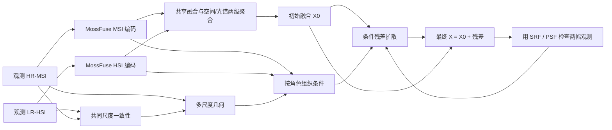

# MossFuse 与几何增强扩散：可行性、结合位置与实验设计

分析日期：2026-10-07。状态：源代码与论文分析、未训练的算子检验、探索性研究方案。没有修改现有模型，没有训练新网络，没有可报告的融合精度提升。

## 1. 结论与推荐路径

**可以结合，结构接口明确；但不能直接把 GEWDiff 的训练目标、边缘噪声和掩码原样搬进 MossFuse。** 最值得先验证的组合是：

> 保留 MossFuse 的共享/互补信息分工与两级聚合，先产生初始融合结果；从观测 MSI 提取几何条件，主要调制空间互补信息；用小型条件残差扩散修正初始结果，并通过原来的光谱/空间退化算子检查最终输出。第一版采用标准噪声，只改变条件注入；第二版才研究可观测光谱方向上的几何噪声预条件。

必须分开三个判断：

| 判断 | 当前证据支持什么 | 不能推出什么 |
|---|---|---|
| 结构可组合 | 四类特征、初始输出和 SRF/PSF 均有明确接口 | 插入模块一定提升精度 |
| 训练可定义 | 监督条件下有残差真值；无真值条件下可在合适尺度构造内部训练对 | 原生尺度无真值自动拥有真实 HR 残差标签 |
| 研究值得做 | 可检验空间先验误传与光谱保真之间的权衡 | 泛泛的“解耦+几何+扩散”已经是新颖贡献 |

工程优先级：几何门控诊断 → 同预算确定性残差网络 → 标准噪声的几何条件残差扩散 → 有充分证据时研究几何噪声预条件。门控版并非扩散方法，应独立命名和报告。

你的工作区当前运行模型是 `model.py` 中的 `Net(lrhs, hrms)`，属于已有监督融合 baseline；它并不是官方 MossFuse。MossFuse 的官方入口是 `MossFuse(MSI, HSI)`，输入顺序相反。要验证“改进 MossFuse”，应先有独立、可复现的 MossFuse 对照；只在当前 Net 上增加模块，不能把其性能变化归因于 MossFuse 解耦机制。

## 2. 本次证据范围

### 2.1 核心论文及代码

- MossFuse：正式 IJCV 论文，2026-03-06，134 卷，文章 152，DOI [10.1007/s11263-026-02757-8](https://doi.org/10.1007/s11263-026-02757-8)。本次完整阅读开放稿 [arXiv:2412.04802v4](https://arxiv.org/html/2412.04802v4)，包括方法、实验、消融和参考文献。缓存元数据 year=2024 来自首版预印本，不能当成正式发表年份。全文完整读取的尾标记：`<!-- END-OF-PAPER:f5ca9f7ca223 -->`。
- MossFuse 官方源码固定到提交 `d6c7eb4a487046aecae5265cabf81b0c23506465`，来自 [作者仓库](https://github.com/dusongcheng/MossFuse/tree/d6c7eb4a487046aecae5265cabf81b0c23506465)。阅读 `MossFuseNet.py`、聚合相关 `net.py`、训练入口、退化算子、数据集代码与解耦损失。可审计副本、来源和哈希见 `author_code/` 与 `source-manifest.json`。
- GEWDiff：沿用同一会话前一轮完整阅读的 AAAI 2026 正式论文及作者代码分析，见 `../gewdiff_transfer_20261007/analysis.md`。正式 DOI [10.1609/aaai.v40i12.37978](https://doi.org/10.1609/aaai.v40i12.37978)。作者代码提交 `1744732922fc74a61f210b7d5f65de2ad4fe1a45`。
- HSR-Diff、DDIF、ARGS-Diff：沿用前轮完整阅读的缓存全文。此次另核实 ARGS-Diff 是 CVPR 2025 正式论文，而非仅有预印本；正式元数据与预印本全文分析分开记录。
- 2025–2026 邻近工作：补充出版方摘要检索，尤其 SSDG、PG-FDN、DifferentialDiff、SDP-Net、WCGE-Net 与 DDSR。未完整阅读的工作只据摘要/明确检索出的相关方法段落评价重叠，不能宣称已经排除所有相似实现。

应用 skill：`research-papers` 与 `research-novelty-review`。这是同一上下文内的自审，不是独立审稿或系统综述。检索日期、近邻重叠和未解决问题见本目录的新颖性文件。

## 3. MossFuse 到底提供什么结合基础

设真实 HR-HSI 为 X，观测为 LR-HSI Y 与 HR-MSI M，理想线性模型为：

\[
Y=\mathcal D(X)+n_H,\qquad M=\mathcal R(X)+n_M.
\]

其中 R 是光谱响应，D 是空间模糊与采样。若 D 对各光谱通道相同、R 空间不变且两幅观测配准，理想关系为 D(M)=R(Y)。实际噪声、SRF/PSF 误差、采样相位和配准偏差会破坏它。

MossFuse 对 M 与上采样后的 Y 分别编码：

\[
(S_M,C_M)=E_M(M),\quad (S_H,C_H)=E_H(\uparrow Y).
\]

| 分支 | 原文角色 | 源码变量 | 几何条件的建议用途 |
|---|---|---|---|
| S_M | MSI 共享信息 | RGB_E[0] | 与 S_H 构成公共上下文 |
| S_H | HSI 共享信息 | HSI_E[0] | 公共上下文、跨观测一致性辅助 |
| C_M | MSI 空间互补信息 | RGB_E[1] | 几何调制的主要对象 |
| C_H | HSI 光谱互补信息 | HSI_E[1] | 保留独立光谱条件，不用 RGB 边缘硬截断 |

公开训练设置 dim=48；这些都是高空间分辨率的 48 通道学习特征。共享特征“语义上支持 LR-MSI 重建”不等于它们就是 3 通道物理 LR-MSI；`base/detail` 也不等于严格的小波低频/高频，更不等于 R 的行空间/零空间。

原 HR 解码器已有交互：

\[
S=\mathrm{Conv}_{1\times1}([S_M,S_H]),\quad
F_1=\mathrm{SA}(S,C_M),\quad
F_2=\mathrm{CA}(F_1,C_H),\quad X_0=\mathrm{Decode}(F_2).
\]

源码 `MossFuseNet.py:195–201` 对应 `fuse → fuse1 → fuse2 → output`。因此不能以“MossFuse 解耦后没有融合交互”为改进动机。它已经用空间感知、光谱感知两级聚合补充信息。

`net.py` 中 `Cross_Spatial_Attention` 也已有学习的 Spatial_Att(y)。新模块应回答“**为什么输入条件中明确的几何和可信程度，比已有的内容注意力更有帮助**”，否则只是重复门控。这里的 q/k 被整理为每头通道×空间，再形成通道间注意力，并非 H×W token 的完整空间注意力。统一乘一个常数还可能被 q 的归一化抵消；应调制空间变化的注意力或实际的互补信息残差通路。

原文还专门讨论信息完整性、盲退化、噪声及退化扰动实验。合理动机是更有针对性地限制不可靠结构传播，而不是笼统宣称 MossFuse 没有约束或没有鲁棒性。

## 4. GEWDiff 哪些思想适合迁移

### 4.1 可以借鉴的部分

1. 将边缘、轮廓、方向等输入条件显式交给生成过程，降低局部结构模糊与漂移的可能。
2. 根据结构位置决定恢复策略，而非只把两个观测拼接后交给网络自行辨识。
3. 分层检验像素、结构和光谱保真，避免只靠可视化判断。

迁移理由是功能互补：MossFuse 指出哪些信息共享、哪些互补；几何条件指出空间细节的位置和方向；残差扩散提供迭代修正方式。这里“可能改善”是待检验假设，不是上述三项自动成立的结论。

### 4.2 不宜照搬的部分

- GEWDiff 的主要实验证明针对单输入 ×4 HSI 超分，不能直接证明 HSI–MSI 融合有效。
- CAVE 的可见光 31 波段不能提供标准 NDVI 所需的近红外。不要照搬建筑/低 NDVI 掩码或把最后一波段当 NIR。
- GEWDiff 的纸面边缘噪声与公开实现的噪声依赖不同；训练扰动和反向采样需共同核对。不能只在训练时给噪声乘边缘图，继续使用未经调整的标准逆过程。
- HR 光谱真值损失在监督数据上可以用，在原生无真值训练中不能用。
- 不建议第一版同时增加谱维压缩、空间小波、语义分割、VGG 和大型 U-Net。MossFuse 已有 SWT 模块；重复使用小波不自动构成贡献。31 波段情况下也未必需要先做压缩。

## 5. 最关键的科学风险：MSI 的边缘不是全部光谱的真值

一种材质边界可能在 RGB 上不明显，但在某个窄光谱带很明显；另一个边缘可能主要来自照明、阴影、MSI 噪声或配准偏差。若要求所有波段边缘都像 M，会出现：

- 真实光谱边界被抹平；
- RGB 纹理被错误复制到缺乏证据的波段；
- RGB 看起来锐利，SAM、局部谱曲线却变差。

因此建议研究的问题是：

> 几何条件是否能有选择地约束 MSI 支持的空间修正，同时让 HSI 提供的光谱互补信息保持足够作用？

这不是把特征通道硬分成“空间=可观测、光谱=不可观测”。物理可观测性必须在重建的光谱域或显式光谱基域定义。

若 R∈R^{3×31} 满行秩，物理光谱投影可以写作：

\[
P_{vis}=R^\dagger R,\qquad P_{null}=I-P_{vis}.
\]

P_vis 是 MSI 可直接测量的光谱方向；P_null 是 MSI 无法直接分辨的方向。它们是 31×31 矩阵，**不能直接乘 48 通道 MossFuse 特征**。有噪声、近奇异或未知 R 时还要报告奇异值、伪逆阈值和估计误差；rank=3 不表示三条方向都同样可靠。

上述分解不是新的数学工具。DDSR 等已有范围/零空间引导扩散，不能把“引入 R†R”作为首次贡献。真正要检验的是在 MossFuse 信息分工下使用它能否降低几何误传，以及这种收益是否超过简单门控/确定性修正。

无真值可辨识性也有上限：可以存在非零 Δ 满足 R(Δ)=0 且 D(Δ)=0，使 X 与 X+Δ 产生相同观测。扩散只能施加学到的先验，无法从相同观测逻辑上唯一证明哪一个是真值。结构一致性也不等于严格拓扑不变性。

## 6. 推荐组合的完整结构



### 6.1 几何图只使用推理时可获得的输入

对 M 每通道梯度构建多尺度结构张量，而不是仅用灰度 Canny：

\[
J(p)=\sum_{c}\begin{bmatrix}g_{x,c}^2&g_{x,c}g_{y,c}\\g_{x,c}g_{y,c}&g_{y,c}^2\end{bmatrix},
\quad \rho=\frac{\lambda_1-\lambda_2}{\lambda_1+\lambda_2+\varepsilon}.
\]

可用条件为边缘强度 e、方向的 cos(2θ)/sin(2θ)、一致性 ρ，及跨尺度稳定程度。方向使用双角表示，避免 θ 与 θ+π 的不连续。每场景/每通道归一化需固定规则；不要用测试集 GT 选择边缘阈值。

第一版采用梯度/张量就足够，不需要语义分割。结构张量只表示观测的局部结构，不自动表示建筑、道路或材质类别。

### 6.2 几何可信程度 C 是软条件

在共同尺度比较：

\[
d=\mathcal D(M)-\mathcal R(Y),\qquad
c_{lr}=\exp\left[-\frac{\operatorname{mean}_c|d|}{\tau+\varepsilon}\right].
\]

τ 应按训练观测的噪声/误差水平标定。再按照正确的采样坐标把 c_lr 对齐到 HR 网格。噪声标准差已知时，可以用标准化残差；未知时，只能称“观测兼容性”，不能称已经校准的真实置信概率。D/R 必须先校准并冻结，避免网络通过修改退化算子把 c 人为变高。

重要局限：合成干净数据满足 D(M)=R(Y) 时，c≈1，无法区分全部 HR 几何真假。低分辨率残差也无法定位每一个高频像素的配准误差。因此这一项应与跨尺度结构稳定性一起作条件，并用受控失配实验验证；不要宣传成万能置信图。

几何条件 G=[e,ρ,cos(2θ),sin(2θ),c]。首版不把 c=0 的位置强制禁止恢复，而是让模型降低对应 MSI 引导的权重。

### 6.3 保留四类条件，改变它们的作用位置

- [S_M,S_H] 经过小型 1×1 投影提供公共上下文。
- C_M 与 G 进入空间调制路径，沿空间位置控制细节注入。
- C_H 进入独立的通道/光谱调制路径，避免被同一 RGB 边缘掩码硬删除。
- 时间 t 或噪声级 σ 进入各层，让作用随去噪阶段变化。
- X0、原始 M 和上采样 Y 提供观测条件；是否需要全部输入由消融判断。

例如某层 denoiser 特征 f：

\[
f'=f+\beta_M(t,p)\,T_M(C_M,G)+\beta_H(t,c)\,T_H(C_H)+T_S(S_M,S_H).
\]

β_M 为位置相关，β_H 为通道相关。它们是可学习的软调制，不证明分支严格独立，也不保证完全不受错误几何影响。需监测光谱分支梯度与 C_H 移除后的性能，判断几何增强是否导致模型忽略 HSI。

### 6.4 扩散预测物理光谱残差

定义 r=X−X0，最终 X_hat=X0+r_hat。第一版让扩散输出 31 个物理波段，先不在未知意义的隐藏特征上定义“真实 HR 残差”。

标准 DDPM 参数化可以是：

\[
r_t=\sqrt{\bar\alpha_t}\,r_0+\sqrt{1-\bar\alpha_t}\,\epsilon,
\quad \mathcal L_{diff}=\mathbb E\|\epsilon-\epsilon_\theta(r_t,t;\mathcal C,G,X_0)\|^2.
\]

残差先用训练数据计算的固定全局标量尺度标准化；采样与最终输出必须逆变换。若后来改成逐波段标准化，要相应变换物理 R 与投影矩阵，不能把原始辐射空间的 P_vis 原样当成标准化空间的正交投影。此方案是真正的**几何条件残差扩散**，但不是逐字复现 GEWDiff 的边缘噪声过程。普通噪声允许我们先独立检验条件是否有效。

后接修正模块的优点：保留原 MossFuse 主体和输出，容易关掉残差获得基线，也能与完全相同条件的确定性残差网络公平比较。缺点：只是外围组合时贡献可能偏弱；需以分工、几何可靠性与光谱保护的实验证据加强。

第一版 denoiser 可从宽度 32、两至三级、31 通道输出开始，四类条件先投影到较小宽度。RTX 3060 12 GiB 上先用 batch=1、64/128 patch 与混合精度做显存预检；这些是工程起点，不是已验证的最佳配置。采样步数比较 8/16/32，并报告真实端到端时间。不得继承 MossFuse 原文单次前向的速度结论。

## 7. 更贴近“几何增强噪声”的第二阶段研究

如果统一噪声+几何条件已有稳定增益，可以研究物理光谱域的预条件；不建议第一版就改完整逆过程。

固定每对输入的 G、R，构建空间变化的 a(p)∈[0.5,1]，例如：

\[
a(p)=\operatorname{clip}(1-\eta e(p)c(p),0.5,1),\qquad
A_G(p)=a(p)P_{vis}+P_{null}.
\]

在边缘可信处减少可直接观测光谱方向的扰动，但不把 MSI 不可见的方向也压成 RGB 边缘。VE 形式为：

\[
r_\sigma=r_0+\sigma A_G\epsilon.
\]

由于 A_G 对当前输入固定且可逆，可以在白化坐标中训练、采样：

\[
u_0=A_G^{-1}r_0,\quad u_\sigma=u_0+\sigma\epsilon,
\quad A_G^{-1}=a^{-1}P_{vis}+P_{null},\quad r=A_Gu.
\]

这样使用同一套标准 VE/EDM 的训练与逆过程，物理观测约束则在 X0+A_Gu 上计算。若优化观测损失，其坐标梯度必须通过 A_G 的转置回传。A_G 空间变化时，D(A_Gu) 不能简单写成在低分辨率输出处乘一个缩小后的 A_G；应计算完整退化算子。

这个构造只是可检查的输入相关坐标预条件：

- 它不产生新观测信息，也不是新的唯一恢复定理；
- 它与噪声/损失加权可能存在等价关系；必须比较等效加权损失，不能把坐标变换包装成全新扩散理论；
- 若 a 依赖 t/σ，上述简单固定坐标等价不再直接适用；要重新推导；
- 若 R 在反向迭代中更新，P_vis 的定义也变化，因此首版必须固定 R；
- 这种物理方向保护不等于完整保护全部光谱细节。有限容量网络仍可能犯错。

这里 VE 公式是可选第二阶段，与第 6 节 DDPM 首版是两种独立的实验参数化，不能混用训练系数和采样器。

## 8. 最大落地难点：无 HR 真值时 r0 从哪里来

### 8.1 有监督版本：最容易检验模块有效性

若训练集提供 X_gt，冻结初始 MossFuse 时：

\[
r_0=X_{gt}-\operatorname{stopgrad}(X_0).
\]

训练标准扩散目标，辅以合适噪声级上的重建/观测损失。第一阶段冻结 backbone，避免 X0 随训练不断变化导致残差分布漂移。随后可做轻度联合微调，目标、checkpoint 与残差尺度均需重新定义。

若在训练中使用 HR 光谱损失/SAM，就是有监督改进版；不能仍称与原 MossFuse 相同的原生无监督设定。你当前 Net 的监督协议可用于先做工程验证，但改进 MossFuse 的结论仍需对应架构对照。

### 8.2 保持观测训练：内部降尺度对

设原生倍率 s，观测为 (Y,M)。在合适尺度上，构造：

\[
X_{int}^{target}=Y,\qquad M_{int}=D_{native}(M),\qquad Y_{int}=D_{int}(Y).
\]

内部模型接收 (M_int,Y_int)，输出与 Y 同大小的 X0_int；其残差训练目标为：

\[
r_{int}=Y-\operatorname{stopgrad}(X_{0,int}).
\]

这是用观测 Y 当内部尺度的目标，不使用原生 HR-HSI 真值。实际目标含观测噪声，不能据此声称学习到无偏干净 HR 分布。推广到原生尺度还依赖跨尺度先验可迁移性，要用独立场景与更大尺度验证。若 CAVE 只有 20 个训练场景，每幅内部目标只有 64×64，其独立结构样本也有限；增强和重叠裁块不能变成新的独立场景，大型 diffusion 有过拟合风险。

**尤其避免隐藏的信息泄漏：** 内部 denoiser 的条件、初始融合、几何图和可信图只能来自 M_int 与 Y_int。虽然原始 Y 在真实系统中是观测，它在这项内部训练任务中已充当目标；不能把未降采样 Y 的编码特征直接再作为条件，否则网络可能复制目标。目标 Y 只进入训练标签与损失。原生推理时输入完整 Y 合法，因为推理目标换成了未知原生 HR 图像。

在内部尺度训练之后，可用原生 (Y,M) 的观测一致性约束微调/引导；原生尺度没有残差真值时，不存在合法的 `r_true = X_HR − X0` 噪声监督。观测损失可约束采样结果，但不能填补所有不可辨识高频。

### 8.3 ×8 与原版 ×32 的具体差别

| 协议 | 原生 HR | Y 大小 | 内部目标 | 内部 LR 输入 | 结论 |
|---|---:|---:|---:|---:|---|
| 当前常用 ×8 | 512² | 64² | 64² | 8² | 可构造首个内部实验，仍需尺度迁移验证 |
| MossFuse 原版 ×32 | 512² | 16² | 16² | 无完整像素网格 | 不宜直接再次 ×32 |
| 原版 128 patch ×32 | 128² | 4² | 4² | 不可用 | 内部空间目标过小 |

作者 `BlindNet` 使用 kernel=scale−1，且 valid convolution。原版 ×32 的 31×31 核不能直接作用在 16×16 或 4×4 的内部目标上。这不只是学习数据少，而是原算子调用也不成立。

可选替代：内部较小倍率+显式尺度条件；更大空间观测场景；观测 MSI 的空间先验/HSI 的光谱先验分别学习后做观测引导。最后一种与 ARGS-Diff 已有路线很近，改造和创新压力都更大。不能把 ×4 内部训练成功等同于 ×32 原生恢复已经有效。

### 8.4 两种常见的伪解法

1. 用 X0 当干净 HR 真值、加噪后让 diffusion 学会恢复 X0：最多学到教师输出分布，没有引入纠错依据；不能证明优于教师。
2. 对观测 MSI 的完整互补特征加噪，条件里又提供同一个干净特征：可能直接复制目标，损失很好看但没有学到融合修正。

隐藏特征去噪可以作辅助正则或替代实验；教师应固定、条件不暴露完整目标、测试改成实际缺失/退化恢复。它并非 HR 光谱残差训练的等价替代。

## 9. 损失设计与原论文/代码的区别

### 9.1 核实到的作者训练入口

固定提交 `train.py:150–168` 的有效损失为：

\[
L_1=0.1L_{decomp}+\|D(X_0)-Y\|_1+\|R(X_0)-M\|_1,
\quad L_2=\|D(M)-R(Y)\|_1.
\]

源码交替让融合参数与 blind 参数参与上述损失。MSI/HSI 自重建、LR-MSI decoder 误差等虽计算和记录，在此版本的实际 L1 中未被加入；HR-HSI L1 也只记录，不参与该训练目标。这与论文完整自监督约束组合不能无条件视为同一实现。

公平比较应二选一并固定：作者当前入口复现，或明确实现论文完整目标。如果扩展时顺带开启原来未启用的损失，应设单独对照，不能把其收益全部算给几何扩散。

### 9.2 推荐首版目标

\[
L=L_{base}+\lambda_{diff}L_{diff}
+\lambda_{obs}\big(\|D(\hat X)-Y\|_1+\|R(\hat X)-M\|_1\big)
+\lambda_{geo}\|w_G\odot(\nabla R(\hat X)-\nabla M)\|_1.
\]

冻结初始 backbone 时 L_base 不给 diffusion 提供训练信号，仅作为基线校验；联合训练时才保留其有效约束。几何损失作用于 R(X_hat) 的 MSI 空间，不能直接要求全部 HSI 波段的梯度都等于 RGB。w_G 是软权重，应对坏几何下的行为做消融。所有损失按元素平均并检查梯度量级，不能照搬 GEWDiff 在不同幅值数据上的权重。

监督版另可加入 HR 像素/SAM；内部观测版可对内部目标 Y 加像素/SAM，但标签带噪时需谨慎；原生无真值只能计算 D(X_hat) 与 Y 的光谱一致性，不能称为原生 HR SAM 监督。

采样阶段可依据观测残差对当前重建估计做小步梯度修正。除非严格推导并验证，不把这种软引导称作精确后验采样。已存在的基础 DC loss 和额外逐步引导也要拆开对比，防止收益来源混淆。

不推荐首版 VGG 感知损失：RGB 纹理偏好未必适合窄带谱保真，且会增加新的收益归因问题。先用可审计的物理观测、像素和结构指标。

## 10. 源码层面应如何接入

### 10.1 第一步：仅几何诊断

改造点：`Decoder_HR.fuse1` / `Cross_Spatial_Attention`。可让 G 调制已有空间注意力及 `DWConv(C_M)` 残差，保留 C_H 的独立聚合。建议额外门控初始化为原模型行为，便于检查关闭模块后输出一致。

注意：在归一化前把 q 整体乘常数未必有效；只给输入 C_M 乘图也不能保证 DWConv 后在所有位置严格归零。需要根据实际注意力与残差通路设计调制，不能凭模块名称假设控制了全部空间注入。

### 10.2 第二步：外围残差 diffusion

建议新增独立 wrapper，而不改写原始作者 forward 的语义：

```text
raw = mossfuse(msi, lr_hsi)
S_M, C_M, S_H, C_H = raw[0:4]
R, PSF, X0 = raw[9], raw[10], raw[11]
G = geometry_from_observations(msi, lr_hsi, frozen_R, frozen_PSF)
r_hat = residual_sampler(X0, S_M, S_H, C_M, C_H, G, observations)
X_final = X0 + r_hat
LR_from_final = spatial_down(X_final, frozen_PSF)
MS_from_final = spectral_down(X_final, frozen_R)
return {initial: X0, final: X_final, residual: r_hat,
        lr_reconstruction: LR_from_final, ms_reconstruction: MS_from_final}
```

这是接口说明，不是已经运行的实现。重要索引是 0-based：raw[11]=初始 HR 输出、raw[12]=其 HSI 退化、raw[13]=其 MSI 退化。如果增加 r_hat 却仍对旧 raw[12:14] 计算 loss，diffusion 分支就没有收到最终输出的观测约束。

需要新增/独立的工作项：几何条件、按角色注入的 denoiser、scheduler/sampler、内部尺度数据集、冻结与联合训练阶段、final 输出评估。建议 dict/named result，避免长 tuple 的索引错误。

### 10.3 退化与坐标对齐不可混用

MossFuse 数据构造用 GaussianBlur 的奇数核 scale−1，再从 (scale/2−1) 位置采样；其退化网络用相同大小奇数核的 valid convolution、stride=scale，中心位置能在内部区域对应起来。边界仍需区分反射 padding 与 valid 支持范围。

你现有监督 Net 协议使用另一个 Gaussian/采样实现。其核尺寸、sigma、采样相位与作者版不同，不应直接拼接 SRF/PSF loss。全图退化后再裁块、正确的边界 halo、旋转/翻转后的采样相位和几何方向变换都应统一检查。

现有 `train_dataloader.py` 中 RealDATAProcess/RealDATAProcess2 已有“把 HSI 当内部目标，再降采样 HSI/MSI”的雏形，可借鉴数据流；但输入排列、HR/LR 网格对应、PSF 和观测身份必须重新核对。不能仅因类名有 RealDATA 就认定不会读取或泄漏真实 HR 标签。

## 11. 可检查的训练顺序

1. **锁定对照。** 固定场景划分、倍率、D/R、数据幅值、损失和 checkpoint 选择规则。原 Net、MossFuse 作者入口和论文目标重建版分别标识。
2. **复现 MossFuse。** 先用已知合成 R/D，确认数据与 forward 相位；再单独评估盲退化，以免算子误差被误诊为几何问题。
3. **几何诊断。** 只加空间调制，记录空间/光谱指标与额外成本。如果无改善或 SAM 持续变坏，先修正门控，而非继续加 diffusion。
4. **固定初始模型与算子。** 创建一致的内部/监督残差目标；先训练确定性 refiner，得到生成模块是否必要的对照。
5. **训练标准噪声 diffusion。** 使用完全相同的信息与目标，仅比较迭代生成的附加价值；先冻结 MossFuse，再单独记录联合微调结果。
6. **原生尺度评估。** 内部尺度成绩与原生恢复成绩分开；原生观测引导与无引导分开。
7. **有证据时扩展。** 引入固定 A_G 白化，比较条件收益、噪声收益与等效加权损失，不把它们混在一个最终模型里仅作移除消融。

全程无真值版不能用原生 HR GT 选择训练 epoch、几何参数、噪声尺度或 best-of-K 样本。如果使用 GT 验证集选择模型，应明示“无 HR 训练标签、GT 验证选模”，不宣称完全不依赖 HR 信息。最终测试集不得参与选模。

## 12. 如何证明结合确实有价值

### 12.1 必须设置的对照

| 编号 | 方法 | 它解决的归因问题 |
|---|---|---|
| B0 | 原 MossFuse，固定有效训练入口 | 基础复现 |
| B1 | MossFuse+几何调制，无 diffusion | 显式几何是否足够 |
| B2 | MossFuse+确定性残差网络，四类条件相同 | 是否只是增加容量/修正器 |
| B3 | MossFuse+残差 diffusion，无显式几何 | diffusion 单独价值 |
| B4 | B3+几何条件，标准噪声 | 推荐首版最终组合 |
| B5 | B4+观测兼容性条件 | 可信程度是否有作用 |
| B6 | B5+物理可观测方向预条件 | 改噪声是否真的必要 |

只报 B0→B6 并逐项去掉模块，容易遗漏“确定性同预算组合已经足够”的反例。至少按参数量/训练更新量对齐，并提供推理时间的质量曲线；diffusion 的多次 denoiser 前向不能被隐藏。

### 12.2 机制实验

- 同一个模型，比较真实几何、平滑图、空间打乱几何、来自另一幅图像的几何；如果都相近，几何机制未得到支持。
- 固定模型，对 MSI 施加 0/0.25/0.5/1 HR 像素偏移与受控噪声；检查可信条件是否响应对应误差。尺寸、噪声量级按训练范围与辐射单位报告。
- 构造 RGB 接近、窄带谱不同的边界，观察是否产生错误锐化；可用真实材质场景和合成光谱零空间扰动两类实验。
- 去掉 C_H、交换 C_H 或抑制其路径，观察 SAM、窄带边界和光谱曲线变化，判断模型是否只依赖 MSI。
- 比较只作用 C_M、作用全部分支、只约束 R(X) 与所有波段硬边缘约束。
- 在已知 R/D 条件下验证机制，再以盲退化误差检验鲁棒性；不能将二者混在同一原因判断中。

### 12.3 指标与统计单位

- 全图：统一定义的 PSNR、RMSE、SAM、ERGAS、SSIM；报告边界裁切、峰值、逐带/全局 PSNR 聚合规则。
- 局部：边缘带/平坦区的误差，代表材质的完整谱曲线，逐带误差图；边缘分区用于评估可基于 GT，但不得回流训练或选模。
- 物理：D(X_hat) 对 Y、R(X_hat) 对 M 的残差；它们低不代表 HR 一定正确。
- 若使用物理分解，报告 P_vis/P_null 的独立误差与 R 的谱；已知 R 的结论不能自动推广到估计 R。
- 多随机种子与场景级配对差值、置信区间；不要把同一场景大量 patch 当作独立重复。
- diffusion 固定采样规则，报告不同随机种子的输出方差；不按测试 GT 挑最好样本。
- 端到端时间、显存峰值、参数、每图采样次数、训练成本；原文数字不替代本机实测。

继续推进的实际条件：B4/B5 在独立场景上比 B1/B2 改善空间细节，同时 SAM/不可见方向误差不系统恶化；坏几何条件下退化更小；额外时间成本可接受。停止 diffusion 路线的条件：同预算确定性 refiner 足够、打乱几何无影响、收益只在内部尺度或依赖 GT 选样出现、光谱明显变坏。此时保留几何/可信调制仍可能有工程价值。

不预设提升多少 dB。若后续要做确认性结论，应先依据场景方差和有意义的改变量设定门槛，而不是看到结果后再选择最有利指标。

## 13. 新颖性判断

已存在：HSI–MSI 条件扩散（HSR-Diff）、残差扩散与小波条件（DDIF/KANDiff）、观测自学习空间/光谱先验（ARGS-Diff）、物理先验引导残差（PG-FDN）、时变空间/光谱解耦调制（SSDG）、两级条件注入与小波细节（DifferentialDiff）、范围/零空间退化纠正（DDSR）、位置相关空间先验与防过锐化（SDP-Net）。其中后几项部分仅核到摘要/方法段落，细节仍待全文对照。

因此：

- “首次把几何加入 HSI–MSI diffusion”：不应主张。
- “首次将空间与光谱条件分开注入”：不应主张。
- “首次用 R†R 区分可观测/不可观测方向”：不应主张。
- “几何增强 diffusion 保证不扭曲光谱/拓扑”：不应主张。

可以暂时保留的窄研究定位：

> 在 MossFuse 共享/互补分工下，检验观测兼容性与物理光谱可观测性是否能限制几何细节误传；以同条件的确定性修正器、标准残差 diffusion 和等效加权损失作对照，判断迭代生成是否值得。

泛化组合新颖性评级 2/5（需要重构定位）；上述窄机制问题评级 3/5（仅有限推进），判断置信度 2/5。不是“顶会潜力分”，也不是实证有效性分。若新近全文已实现同样的可靠几何/可观测方向控制，需进一步收窄或放弃新方法主张。

## 14. 本次实际验证与最后判断

运行了未训练、float64 的小型算子检查，结果见 `algebra-results.json`：

- A_G 逆变换最大误差约 3.1×10⁻¹⁵；坐标梯度链最大误差约 1.3×10⁻¹⁵。
- 随机满行秩 3×31 SRF 下，构造范数=1 的非零 Δ，两幅观测的变化分别约 3.0×10⁻¹⁸ 与 1.9×10⁻¹⁸，支持不可辨识性说明。
- 空间变化的几何缩放与空间退化并不交换，当前随机实例差约 0.0108；不能采用“先 D 再乘中心门控”的快捷实现。
- ×32 原版内部训练的尺寸/valid convolution 问题得到明确形状检查。

这些仅支持公式、坐标链与尺寸分析。没有对完整网络做训练、显存压测、采样收敛验证或融合性能评测。当前活动 baseline 文件哈希前后相同。

**推荐：值得做一个分阶段、可归因的探索，但先在 ×8、已知 R/D 的受控协议下验证几何调制与残差条件，再保持观测训练；原版 ×32 的无真值 diffusion 应作为独立难题，不能承诺直接移植成功。** 真正的成败标准是空间细节改善时光谱是否保持可信，以及扩散是否比简单修正器多带来值得其代价的收益。
