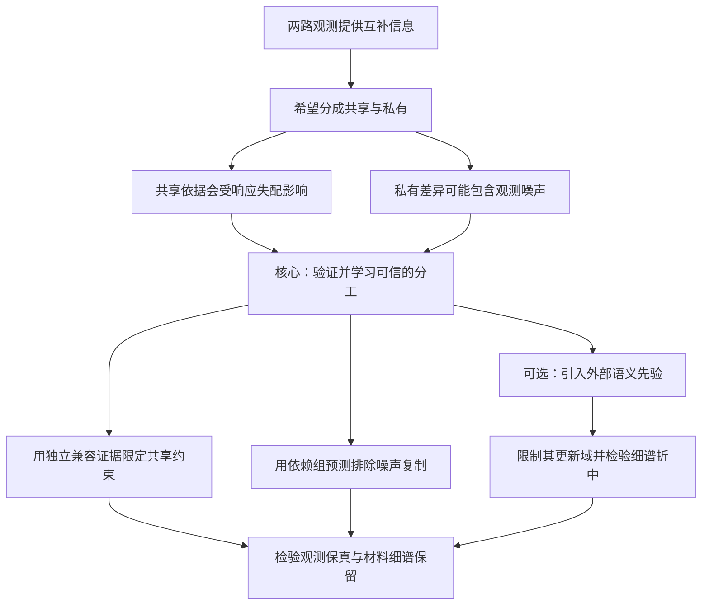

# P01｜MossFuse：三个动机、具体机制与研究故事的进一步推导

> 更新日期：2026-10-06。对象：当前 `model.py` 的 HSI–MSI 融合 baseline。
>
> 本文是文献与代码支撑的探索性推导。没有开展新的训练，没有确认 MossFuse 出现下文假设的失败，也没有确认这些方案具有发表级新颖性。本文把每条假设的成立条件、最小验证和否定条件一起写出，方便你决定值得研究什么。

**建议将三个点归到一个中心问题：在传感器响应、噪声与语义先验共同作用下，如何让共享／私有分支形成可信的分工？**

这个中心问题可以拆成三个递进的问题：

1. **共享依据是否可信？** 两路观测的差异，来自材料，还是来自退化模型失配？
2. **私有内容是否可信？** 只有一个模态看得到的内容，是真实互补信息，还是该模态特有的噪声？
3. **外部先验的权限是否合适？** 语义模型提供结构帮助时，是否干扰了本应保留的细谱与幅值？

前两个点适合作为当前项目的一条主线。第三个点是引入预训练教师之后才存在的扩展问题，不必为了凑三个创新点而同时增加三个模块。

## 阅读导航

- [先修正对原文局限的判断](#evidence)
- [共同的成像模型与四类差异](#foundation)
- [动机一：响应不确定导致共享依据漂移](#idea-1)
- [动机二：噪声可能伪装成私有互补](#idea-2)
- [动机三：语义泛化与细谱保真的权限边界](#idea-3)
- [在你的 baseline 中怎样落地](#implementation)
- [筛选、最小验证与停止条件](#selection)
- [怎样讲成一个连贯的研究故事](#story)
- [审稿人可能提出的问题](#review)

<a id="evidence"></a>

## 1. 深入之前：需要更准确地理解“原文的缺点”

### 1.1 本次核对后，对上一版 P01 的补充

原文已经有退化估计；§4.4 已评估 SRF／PSF 扰动和输入泊松噪声，并有分支可视化、分类及材料辨别分析。§5 提出进一步探索噪声、退化和预训练语义方向。因此，不能将“原文不处理未知退化、不考虑噪声、不研究材料差异”作为动机。[MossFuse 原文 v4](https://arxiv.org/html/2412.04802v4)

**本文的新问题是：在这些扰动下，分支究竟把什么存成共享、什么存成私有；以及是否能同时减少干扰、保留互补信息。** 这是对分工机制的待检验问题，不是根据总体指标认定原作无效。

这也更新了上一版的证据范围：上一版主要检查共同域依据与结论，本次进一步检查了方法、算法分析及公开训练入口。旧文件保留历史，本文件涉及 P01 的判断以这里的更细边界为准。

### 1.2 三个点的证据类型并不相同

| 点 | 已有依据 | 本文进一步提出的假设 | 不能直接写成事实的内容 |
|---|---|---|---|
| L1：共享依据漂移 | 共同观测域、退化估计及失配测试已经存在 | 错误或不确定的响应，会使分支把成像差异存成材料差异 | “MossFuse 的共享分支已经被响应误差污染” |
| L2：噪声伪私有 | 噪声鲁棒性已有评估；作者继续关注噪声方向 | 模态特有且可预测的噪声，可能满足私有分支的分离目标 | “已有实验已证明私有分支记住噪声” |
| L3：语义权限 | 预训练与语义属于作者提出的拓展方向 | 强语义约束可能偏好类别稳定性，和细谱／幅值保真发生冲突 | “当前 MossFuse 已使用语义教师并产生压谱问题” |

本文提出的训练机制、反事实测试与故事组织均为本项目推导。

### 1.3 公开代码提供了什么依据

静态读取时，`MossFuseNet.py` 的编码器返回两类特征，最终 HR 解码器聚合四路表示。这支持借鉴分工思路；它的最终重建路径与当前 baseline 的 `hsi_up + tail(f)` 不同。[公开模型源码](https://github.com/dusongcheng/MossFuse/blob/main/MossFuseNet.py#L189-L215)

公开 `train.py` 当前入口中，实际反向传播的 `loss1` 是分解项与两路输出观测误差，`loss2` 是共同观测兼容误差；另有若干计算、记录的损失。因此迁移时应追踪实际参与更新的目标，不能把所有日志项都视为训练约束。该入口还使用 HR-HSI 做指标监测；这与将 HR-HSI 放进反向传播损失要区分。[公开训练源码](https://github.com/dusongcheng/MossFuse/blob/main/train.py#L98-L149)

以上仅为读取当日 `main` 源码的观察，未运行复现，也不能据此将这个入口等同于期刊全部实验配置。

<a id="foundation"></a>

## 2. 先建立一个能解释三个问题的共同模型

### 2.1 符号与尺寸

使用 PyTorch 的通道优先约定，省略 batch：

| 符号 | 含义 | 当前例子 |
|---|---|---|
| \(X\) | 理想 HR-HSI，研究中训练时不可见 | \(31\times H\times W\) |
| \(Y_h\) | 观测 LR-HSI | \(31\times h\times w\) |
| \(Y_m\) | 观测 HR-MSI | \(3\times H\times W\) |
| \(R_*\) | 真实光谱响应，把 31 波段映射到 3 通道 | \(3\times31\) |
| \(D_*\) | 真实空间退化：模糊、采样及坐标／边界约定 | HR → LR |
| \(n_h,n_m\) | 两个观测域的噪声 | 各自的观测尺寸 |

最初限定研究对象为已配准、线性、空间不变的响应与各波段相同的空间退化：

\[
Y_h=D_*X+n_h,\qquad Y_m=R_*X+n_m.
\]

这里 \(R_*X\) 表示逐像素的光谱矩阵乘法。不要将 \(R\) 直接乘到 64 维隐藏特征上：64 个学习到的通道并不等于 64 个物理波段。

若空间算子与光谱算子可交换，并使用同一坐标及有效边界，则理想无噪声条件下：

\[
R_*Y_h=D_*Y_m.
\]

两边都是 **3 通道 LR-MSI**。所以“共同域”首先是一个可比较的观测域，而不是要求两路全部隐藏特征逐元素相等。

### 2.2 为什么同一材料也可能出现共同域差异

设手上只有名义参数 \(R_0,D_0\)，定义：

\[
e=R_0Y_h-D_0Y_m,\quad
\Delta R=R_0-R_*,\quad \Delta D=D_0-D_*.
\]

代入上面的模型，在可交换条件下得到：

\[
\boxed{
e=\Delta R D_*X-\Delta D R_*X+R_0n_h-D_0n_m.
}
\]

这个等式是本文的基础分析。它说明共同域的差异可能由两类东西组成：

- **系统性的成像误差**：\(\Delta R D_*X-\Delta D R_*X\)。其形状与场景内容有关，甚至可能看起来很像材料纹理。
- **传播后的观测噪声**：\(R_0n_h-D_0n_m\)。光谱混合和空间模糊会改变它的相关性。

仅看到 \(e\neq0\)，并不能判定存在应该保留的私有材料信息。

反过来，\(e\) 很小也不能证明输出光谱准确。某些 HR-HSI 改变量 \(\delta X\) 可以同时满足 \(R\delta X=0\) 和 \(D\delta X=0\)。这些方向无法由两路观测直接确定，仍需先验；本文任何机制都不能凭空恢复全部不可观测成分。

### 2.3 三种“不共享”必须区分

| 内容 | 为什么不共享 | 是否值得保留 | 应当如何处理 |
|---|---|---|---|
| HSI 的真实细谱 | MSI 的少量宽响应不能完全分辨 | 值得，至少保留 LR-HSI 实际支持的差异 | 观测锚定、受约束的私有通路 |
| 响应或采样失配 | 两路使用了不一致的成像解释 | 不应作为材料属性记忆 | 校准、候选算子及共享约束的可信度 |
| 模态特有噪声 | 只出现在一个观测模态 | 通常不值得 | 在明确噪声条件下做遮挡预测、干预检验 |

所以“私有”只是跨模态关系上的概念，尚未回答信息质量问题。

空间变化 SRF、波段相关 PSF、严重未配准或饱和非线性会进一步破坏以上简单共同域模型。第一版不同时解决这些情况；否则无法分辨收益究竟来自哪项机制。

<a id="idea-1"></a>

## 3. 动机一：共同域存在，并不意味着共享监督同样可信

### 3.1 从一个具体情景理解失配

想象同一块叶片：HSI 测到某个窄波段的吸收变化，MSI 的绿色通道覆盖较宽范围。

若你使用的绿色响应比实际传感器偏移一点，将 HSI 投影成 RGB 后，绿色数值可能与实际 MSI 不一致。此时材料没有变，差异来自响应解释。

如果训练目标要求两路强行共享，网络有几种可行的补偿方式：修改 HSI 分支表示、弱化吸收差异、把响应差异留进私有分支，或者让最终解码器抵消它。哪一种发生，需要检验，不能从网络名称判断。

**更具体的动机：学习到的共享／私有分工，可能依赖某个响应估计，而非稳定地依赖材料互补性。**

### 3.2 假设 H1：响应不确定会造成分工不稳定

可检验的表述是：

> 对同一潜在场景，改变名义响应或校准可信度，会使私有分支的解码贡献发生非材料性的变化；将共享约束绑定到独立校准得到的兼容证据，可能减少这种变化。

重点在“分工变化”的定位。单纯证明参数不准会降低 PSNR，只是一般的退化失配现象。

建议先区分两种实验：

1. **同一观测，改变名义算子**：检查模型解释的敏感性，材料与观测值都不变。
2. **同一场景，改变真实传感器**：重新生成观测，再检查迁移效果。这里 MSI 可见的光谱子空间本来就会改变，不能要求所有私有表示完全不变。

第一种更容易定位人为校准误差；第二种才支持跨响应推广。

### 3.3 候选机制 A：候选响应支持下的共享辅助监督

初版流程可以很小：

1. 从独立校准区域得到少量候选 \(\{R_k,D_k\}_{k=1}^K\)，例如 3–5 组。使用非负、归一化、低自由度的参数化。
2. 在独立观测验证区域检查候选的兼容误差，排除明显不合理者。校准、验证与被遮挡目标要有空间间隔，避免相关噪声泄漏。
3. 对每个保留候选计算共同观测 \(c_h^k=R_kY_h\)、\(c_m^k=D_kY_m\)。
4. 用候选间的预测分歧和共同域兼容程度，形成共享辅助约束的固定可信度。
5. 主输出的观测约束保持固定权重；可信度只调节额外的分工约束。

不需要一开始学习自由的 \(3\times31\) 响应、PSF、配准、增益和大网络。可先固定正确 PSF，仅研究 SRF 的中心／宽度扰动，或反过来固定 SRF。联合盲估计留给后续。

**候选分歧不是自动校准的概率置信度。** 3–5 个候选一致，可能是它们一起错了；候选很分散，也可能只是参数不可辨识。应先称“候选分歧指标”，并检验它与失配风险的关联。

还要检查校准区域是否具有足够的光谱变化。若一片区域几乎只有同一种材料，多组响应可能产生相近共同域误差；很低的校准残差并不代表响应已经可辨识。此时应报告候选范围、使用名义先验，或收缩到已知响应设置，不能强行输出一个高可信度的点估计。

**独立校准消除的是目标泄漏，并不自动消除含噪自变量带来的估计偏差。** 例如固定正确 \(D\)，并假设两路噪声独立、均值为零，拟合 \(R\) 时有：

\[
\mathbb E\|R y_h-y_{m,\rm LR}\|_2^2
=\|(R-R_*)x_{\rm LR}\|_2^2
+\operatorname{tr}(R\Sigma_hR^\top)
+\operatorname{tr}(\Sigma_{m,\rm LR}).
\]

这里取一个 LR 像素：\(x_{\rm LR}=(DX)_j\)、\(y_h=(Y_h)_j\)、\(y_{m,\rm LR}=(DY_m)_j\)，而 \(\Sigma_h\) 和 \(\Sigma_{m,\rm LR}\) 是该处给定场景后的 31 维 HSI 噪声、3 维退化 MSI 噪声协方差。这是上述简化成像模型的推导。目标中随 \(R\) 改变的噪声项，会影响最优响应。因此，单纯最小化兼容误差可能偏向更分散或更平滑的响应，不能把训练残差下降直接解释为物理校准更准。

初版最稳妥的研究顺序是：先用已知响应附近的受约束候选测试分工机制，再研究真实盲校准。若有可靠噪声协方差，才能进一步考虑校正估计目标；没有时，比较名义响应、普通拟合、候选先验，并明确校准偏差可能仍然存在。这样第一、二个动机也形成具体连接：噪声不仅影响私有内容，还可能影响用于定义共享的响应估计。

### 3.4 怎样定义可信度与损失

以下是可落地的初始形式，不是已确定最优目标。对固定的 LR 区域 \(b\)，设：

\[
e_k(b)=c_h^k(b)-c_m^k(b),\qquad
q_k(b)=\tfrac12\big(c_h^k(b)+c_m^k(b)\big).
\]

\(q_k\) 只是两路共同域观测的平均，仍可能有噪声或偏差，**不能直接叫干净共享真值**。若有可靠噪声方差信息，可用固定方差加权平均；没有时不要宣称得到最优融合估计。

用尺度标准化后的 \(e_k\) 和候选 \(q_k\) 的分歧定义固定的 \(g(b)\in[0,1]\)。例如：

\[
g(b)=\exp\!\left[-a\,\operatorname{median}_k\|W e_k(b)\|_2^2
-b_0\operatorname{Var}_k(Wq_k(b))\right].
\]

这里 \(W\) 只使用校准／可见数据估计的尺度或噪声变换；\(a,b_0\) 经独立验证选取，不由融合网络自由输出。该公式是启发式门控，不具有自动的概率解释。

对 HSI 共享头的 LR 输出 \(S_h\) 和 MSI 共享头经真实空间算子退化后的输出 \(D_kS_m\)，可以定义：

\[
\mathcal L_{\rm share}
=\sum_b g(b)\sum_k\rho_k
\left[
\ell(S_h(b),q_k(b))+
\ell((D_kS_m)(b),q_k(b))
\right],
\]

其中辅助头输出物理意义可比较的 3 通道图，\(\rho_k\) 是冻结的候选权重；可添加两路预测间的兼容项。共享头解码到共同域，仍不证明隐藏特征具有唯一的共享解释。

主观测项单独保留：

\[
\mathcal L_{\rm obs}
=\ell(D_{\rm anchor}\hat X,Y_h)
+\alpha\ell(R_{\rm anchor}\hat X,Y_m).
\]

\(R_{\rm anchor},D_{\rm anchor}\) 可以是独立校准选定的参数，不能借助 HR-HSI 选取。不要让 \(g\) 同时关闭这个主目标，否则网络可通过“都不可信”逃避重建。

**与动机二合并训练时要改写这个形式：** 若目标 \(Y_{h,J}\) 已被遮挡，则 \(q_k\)、\(g\)、\(\rho_k\)、归一化统计和算子估计都不能使用它。冻结一个由完整目标计算出的量，并不会消除泄漏。此时应使用独立校准得到的区域／全局可信度，并把辅助项限制在合法可见区域或预测之间，见第 4 节。

### 3.5 进一步的新思路：先诊断“错共享发生在哪里”

比全局给一个置信度更有价值的扩展，是研究 **共享分工的失配敏感方向**。

在同一场景上，对响应中心、宽度或 PSF 宽度做单因素扰动，测量共享／私有分支解码贡献与最终窄峰误差的变化。若变化集中在若干响应边界附近的光谱方向，可以据此设计方向选择的共享约束。

这一步不必首先做复杂雅可比正则。先用有限差分找规律，再决定是否值得引入响应条件编码或方向约束。通过已知正确算子的控制实验排除采样坐标错误，否则所谓“响应敏感性”可能只是代码网格错位。

### 3.6 如何证明不是普通的置信度加权

必须至少比较：同算子、同训练预算下的普通共享约束；全局降低共享损失权重；随机门控；仅更准确地校准；以及候选支持的门控。

若全局降低权重就同样有效，最合理的解释是原辅助项过强。若仅换正确算子就解释全部收益，说明校准重要，但不支持额外的“分工不确定性机制”。

还要检查私有贡献是否随响应误差变化、这种变化是否与输出材料光谱偏差相关。**只报告门控热图与最终 PSNR，证据还不足以支持分工机制。**

### 3.7 这一点能够怎样讲故事

通俗讲法：两台仪器看同一块材料，如果它们对颜色和模糊的解释不一致，先要求它们“说同样的话”可能会逼其中一台改掉真实信息。应先检查共同解释是否可靠，再决定共享约束要多强。

研究讲法：共同观测域的存在是理想成像条件下的关系；实际学习使用的是估计算子。本文拟研究从成像估计误差到分工变化的传播，并用独立兼容证据限定共享监督的作用。只有在控制校准精度和损失强度后仍成立，才能形成该方向的贡献。

<a id="idea-2"></a>

## 4. 动机二：私有信息不等于有价值的信息

### 4.1 为什么这个问题比“加入去噪模块”更具体

某个 HSI 波段的条纹只出现在 HSI，而 MSI 中没有。真实窄吸收峰也可能只有 HSI 能分辨。

它们都具有“另一模态没有”的性质。若训练只鼓励私有特征与共享特征分开、同时重建含噪输入，条纹并不一定违背目标：它可能是需要重建的模态专属内容。

因此这里的动机是：**模态分离目标没有单独保证私有分支的内容是真实信号。** 这是一条待验证的机制假设；某些网络先验已能抑制噪声，不能预设原作一定失败。

### 4.2 假设 H2：对噪声不敏感，对材料差异敏感

需要同时成立的两个要求是：

\[
\text{同一场景、不同噪声}\Rightarrow\text{私有解码贡献尽量稳定};
\]

\[
\text{MSI 近似同色、真实细谱不同}\Rightarrow\text{私有通路保留差异}.
\]

只满足第一条不够。全零私有分支、强平滑输出甚至一张固定图都可能稳定。

这是本文对第二点最重要的细化：**把“抑制噪声”和“保留弱互补”做成一对必须同时通过的验证。**

### 4.3 候选机制 B：面向观测的分组遮挡预测

首先固定已知 \(R,D\)，研究输入噪声；不要同时学习响应不确定性。

取 HSI 原始观测中的目标组 \(J\)，以及根据噪声相关范围设计的保护带 \(G(J)\)：

\[
\tilde Y_h=\mathcal M_{J\cup G(J)}(Y_h).
\]

\(\mathcal M\) 使用不依赖被遮挡值的常量或可见邻域填充，并提供显式 mask。网络从 \(\tilde Y_h\) 和独立 MSI 观测预测 HR-HSI，再降回原始 HSI 网格：

\[
\hat X^{(-J)}=f_\theta(\tilde Y_h,Y_m),\qquad
\mathcal L_{h,\rm hold}=\frac1{|J|}
\sum_{j\in J}\big[(D\hat X^{(-J)})_j-Y_{h,j}\big]^2.
\]

损失只在目标 \(J\) 上计算；保护带是防相关噪声绕过遮挡，不一定也作为预测损失目标。独立 MSI 可以保留，为预测提供真实结构线索。

### 4.4 这个损失在什么条件下有统计依据

若被遮挡组的观测噪声条件均值为零，并且给定潜在场景后，与所有可见输入中的噪声条件独立；整个预测路径也不读取该目标，那么平方误差的观测风险等于对应干净观测预测风险加一个与模型无关的噪声项。这是已有 Noise2Self 原理，而非本文新增理论。[Noise2Self 论文，命题 1](https://proceedings.mlr.press/v97/batson19a/batson19a.pdf)

把这些条件迁到融合中，只能得到 **被遮挡观测域** 的依据，不等于无条件保证恢复真实 HR-HSI，也不保证整个网络所有辅助损失都无偏。L1 对应的统计目标与平方误差不同，不能直接沿用上述风险等式。

若仅是近似独立，应报告近似程度及残余偏差；如果整列条纹噪声在可见区域中仍可预测，遮挡单个像素不成立。组大小应来自噪声依赖假设或独立校准，不是为了让效果最好而任意改名。

### 4.5 你当前 baseline 最容易出现的四种泄漏

**第一种：插值残差路径。** 你的输出含有 `hsi_up`。必须先遮挡原始 LR-HSI，再计算 `hsi_up`；只遮挡深层特征，原目标仍可从插值路径进入预测。

**第二种：投影之后再遮挡。** \(RY_h\)、\(Q_RY_h\) 或 PCA 会混合波段。若先用完整 HSI 计算，再遮挡其中一个结果，被挡波段的值可能已进入其他通道。

**第三种：校准与归一化缓存。** 从完整目标计算出来的响应、共享置信度、光谱基或样本均值，即使 `detach` 也仍然携带目标。目标相关的信息不能参与这次预测与目标相关权重。

**第四种：双视图共享原始噪声。** 向同一张含噪图分别再加一次随机噪声，两张图仍共享原本的噪声，不能自动视为两次独立采集。

因此合理的计算顺序是：原始观测确定 mask → 删除目标及保护带 → 从剩余可见量计算允许的变换与输入 → 前向预测 → 使用保存的原始目标计算损失。

训练统计上的独立性还要求分组方案本身不能通过读取目标噪声来选择“容易”或“困难”的目标。先使用与观测值无关的固定／随机分组，再研究更复杂的选择机制。

### 4.6 怎样把观测遮挡与“私有分支”真正联系起来

仅将主网络改成遮挡预测，可以形成自监督去噪融合训练，但尚不能证明私有分支发生了预期改变。

可以增加一个可解释的 LR 端分工探针。对固定且满行秩的 \(R\)，定义：

\[
Q_R=R^\top(RR^\top)^{-1}R,\qquad Q_R^\perp=I-Q_R.
\]

它们分别指向 MSI 可见的光谱行空间与其正交补。若数值病态，可使用 SVD 截断并报告阈值；加入 \(\epsilon I\) 的形式是正则化近似映射，不是严格正交投影。

用两路小头输出 31 通道 LR 图：

\[
\hat y_h^s=Q_R C_s(F_h^s),\qquad
\hat y_h^p=Q_R^\perp C_p(F_h^p),\qquad
\hat y_h=\hat y_h^s+\hat y_h^p.
\]

把 \(\hat y_h\) 的预测与 **原始被遮挡观测** 比较：

\[
\mathcal L_{\rm split,hold}
=\frac1{|J|}\sum_{j\in J}(\hat y_{h,j}-Y_{h,j})^2.
\]

两个头及其输入均不能看到被挡目标。这里的光谱子空间分工是人为规定的一种可解释辅助形式，并不等于完整的非线性材料解耦，也不覆盖 MSI 的空间私有信息。

**一个需要避免的做法：** 不要直接把完整 \(Q_R^\perp Y_h\) 当作遮挡私有目标，再按原始波段分组声称独立。投影会把可见波段噪声混入目标，也把被挡波段噪声混到其他位置。先在原始观测域保证不泄漏，再决定哪些辅助分工是合法的。

这个 LR 探针还不能保证主 HR 解码器使用该分工。应结合分支替换、消融和最终输出的光谱差异验证；必要时让探针与实际融合使用同一组分支，而非只训练一个旁路解释头。

### 4.7 怎样处理相关噪声，而不是只增加一个 mask

可按复杂度分三步推进：

| 阶段 | 噪声假设 | 初始遮挡方式 | 必须检查的失败 |
|---|---|---|---|
| A | 跨模态独立、观测像素／波段独立的零均值噪声 | 固定随机组；原始域遮挡 | 跳跃路径与统计泄漏 |
| B | 有限空间／光谱相关长度 | 目标组与保护带；保留足够可见信息 | 扩大保护带后仍复制相关噪声，或真实细谱被平滑 |
| C | 整列／整行、跨模态共享或长期漂移噪声 | 必须遮挡其依赖支持，或增加独立采集／校准依据 | 依赖支持太大，现有单对观测不足以区分信号与噪声 |

初版建议做 A，再做一种明确的 B。对 C，不应承诺通用解决：若干扰和材料具有同样的可见依赖结构，单对观测本身可能缺乏辨别依据。

模拟噪声还要区分“HR 场景加噪后再退化”与“观测采集端加噪”。前者可能在 HSI 与 MSI 中产生共享噪声，后者可以模拟独立传感器噪声。论文中必须说清楚采用哪一种。

### 4.8 怎样验证私有分支既不记噪声，又不丢材料

**噪声干预：** 对同一干净场景生成多次独立观测噪声，固定真实 \(R,D\)。检查私有分支的解码贡献、输出残差与噪声图的关联。真实单次观测再加随机噪声，只能测试额外扰动敏感性，不能替代独立重复采集。

**材料干预：** 构造 \(\delta X\)，使 \(R\delta X\) 很小，而 \(D\delta X\) 非零。这样差异主要由 HSI 支持。检验模型是否保留已被 LR-HSI 测到的细谱变化。

**分支交换：** 同一场景的两次噪声观测之间交换私有特征，并比较解码后的结果；再在 MSI 近似同色、HSI 细谱不同的材料样本之间做受控交换。每次固定其他输入，避免把全部分布改变当作分支作用。

这些交换仍可能造成表示分布外输入。因此它们是诊断证据，应与原始合法输入上的最终输出指标、物理探针和普通消融共同使用。

不要只比较不同模型私有特征的范数。隐藏表示可以重标度、旋转；跨模型应主要比较其解码到物理观测后的贡献。

### 4.9 更有研究价值的细化：依赖范围与细谱保留之间的冲突

遮挡越大，越难复制相关噪声；但能用于恢复稀有材料细谱的邻域证据也越少。

因此可进一步研究：**噪声依赖长度增大时，私有细谱保留在哪个尺度开始退化；是否能利用独立 MSI 的结构支持降低这个代价？**

这比“空间光谱随机 mask”更明确，因为它提出一个可测的冲突。若 MSI 无法区分两种材料、可见 HSI 又没有相应证据，那么扩大 mask 后丢掉细谱不应被包装成成功去噪，而是可辨识性边界。

### 4.10 这一点能够怎样讲故事

通俗讲法：两台仪器都能看到的内容比较容易互相核对；只有一台看到的内容最值得补充，也最难辨别真假。我们要求它利用没有藏着同一份噪声的线索预测这部分内容，同时检查真实材料细节是否保住。

研究讲法：模态互补性与信息可靠性是两种不同性质。本文拟用明确依赖分组的观测遮挡，限制私有通路复制目标噪声；并联合噪声干预与材料干预，检查其是否形成对干扰稳定、对互补信号敏感的功能。

<a id="idea-3"></a>

## 5. 动机三：语义先验需要权限边界，不能替代细谱证据

### 5.1 这个问题什么时候才存在

当你增加外部预训练模型或语义教师，希望改善跨场景、跨传感器泛化时，这个问题才成为具体的设计对象。

某个教师擅长识别树木、道路和建筑，这并不代表它能分辨某个窄波段的吸收深度。若它主要从 RGB 训练而来，MSI 接近同色的两种材料可能得到相近表示。

“教师不敏感”不等于“蒸馏一定删除该差异”。冲突是否发生，取决于蒸馏作用的位置、权重、归一化和更新路径。本文要检验的正是这些条件。

### 5.2 一个可以手工构造的例子

用 6 波段、3 通道的简化响应说明，三个 MSI 通道分别平均相邻两个波段：

\[
R=\begin{bmatrix}
\frac12&\frac12&0&0&0&0\\
0&0&\frac12&\frac12&0&0\\
0&0&0&0&\frac12&\frac12
\end{bmatrix}.
\]

取两种材料光谱：

\[
x_A=(0.4,0.6,0.5,0.5,0.5,0.5)^\top,\qquad
x_B=(0.6,0.4,0.5,0.5,0.5,0.5)^\top.
\]

它们有不同的细谱，但：

\[
Rx_A=Rx_B=(0.5,0.5,0.5)^\top.
\]

只从 MSI 获得的教师，在这个例子中没有依据判断哪个光谱正确。HSI 观测若保留了这两种材料的 LR 证据，就应该继续决定它们的差异。

这不是说真实 RGB 响应恰好是两波段平均。它是一个用于理解与验证的可控例子。实际 31 波段测试可以通过真实 \(R\) 的零空间构造小扰动，同时保持光谱非负、数值范围合理，并检查 LR 退化后仍有可见差异。

生成这类成对例子时使用共同、固定的辐射归一化尺度。如果给两种材料各自按最大值归一化，可能重新改变 MSI 幅值，使原本的“同色异谱”控制失效。先验证 \(\|R\delta X\|\) 足够小而 \(\|D\delta X\|\) 非零，再将它作为材料保留测试。

### 5.3 假设 H3：语义干预的范围影响细谱保留

可检验表述：

> 全特征蒸馏和受观测子空间限制的语义干预，在教师强度相近时，对 MSI 弱可见、HSI 可见的细谱变化产生不同影响；限制语义更新通路，可能改善细谱保留与结构迁移之间的折中。

它研究的是 **语义帮助的作用边界**，而不是“高光谱融合首次引入教师”。已有融合蒸馏研究，例如 CSAKD；其旧代码地址在本次访问时重定向到作者的 S³RNet 仓库。不能把旧稿的投稿信息当成已接受的 TIP 信息。[CSAKD 原稿](https://arxiv.org/abs/2406.19666)、[当前作者仓库](https://github.com/ming053l/S3RNet)

语义指导融合本身也已有相关工作：CO²IF 使用语言语义引导 HSI–MSI 融合。这里仅用其作为新颖性边界，本次没有核对其代码可复现性。[CO²IF 官方论文页](https://ojs.aaai.org/index.php/AAAI/article/view/38261)

### 5.4 候选机制 C：限制教师的输入域与更新域

首先使用冻结教师 \(T\)，并保证其输入通道、归一化、动态范围与预训练约定匹配。将预测 HR-HSI 投影到 MSI 域，再提取语义：

\[
\mathcal L_{\rm sem}
=\big\|T(BR\hat X)-\operatorname{sg}[T(BY_m)]\big\|_2^2.
\]

\(B\) 是两路相同、预先规定的空间低通或降采样；\(\operatorname{sg}\) 表示目标教师特征停止梯度。低通尺度可与研究的 PSF 可见带宽关联，不必一开始选择任意的大尺度平滑。

通过 \(R\hat X\) 施加语义，已经避免直接让 31 个波段分别匹配 RGB 教师的特征。但是它仍有一个容易忽视的边界：

- 在固定输出 \(\hat X\) 的空间中，语义损失梯度经 \(R^\top\) 回传，不能直接分辨 \(\ker R\) 的光谱变化。
- 在网络参数空间中，共用卷积权重更新后，仍可能间接改变那些光谱成分。

**所以仅在公式中乘一个 \(R\)，不能承诺私有细谱完全不受影响。**

### 5.5 更强但更可解释的版本：输出端受限语义适配器

将基础融合结果和语义修正分开：

\[
\hat X_{\rm final}
=\hat X_{\rm base}+Q_R B_{\rm out}A_\psi(Y_m,\hat X_{\rm base}).
\]

其中 \(A_\psi\) 是小型适配器，\(B_{\rm out}\) 限制其空间频率；\(Q_R\) 作用在输出物理波段上。语义训练阶段冻结基础重建网络及 \(R\)，仅更新 \(\psi\)。

在使用精确正交投影、固定基础输出的这个阶段：

\[
Q_R^\perp\hat X_{\rm final}=Q_R^\perp\hat X_{\rm base}.
\]

这给出一个很明确的设计含义：教师不能通过这个适配器直接修改名义响应零空间中的光谱成分。它仍可能修改 MSI 可见方向的幅值或光谱形状，因此主观测约束必须继续作用于最终输出。

如果使用近似投影，以上关系只是近似；如果 \(R\) 不准，被保护的是名义子空间，不是未知真实传感器的零空间。此时应先研究第一个动机，不能直接宣称实现传感器无关的保护。

“保护住基础结果”也不等于基础结果正确。若基础网络已经丢掉细谱，受限适配器只能避免这一步进一步修改它，不能凭教师找回不可见差异。

这一版本适合先做阶段式训练：基础自监督融合 → 冻结基础网络 → 受限语义适配。将教师损失直接混进全网络联合更新，可以作为对照，但不再具有上述冻结阶段的输出约束。

### 5.6 教师到底能提供什么新的信息

如果教师输入的是同一张 MSI，它并没有获得新的传感器测量；它提供的是从外部数据学到的结构先验。若输入和模型都冻结，这些特征是观测的函数。

因此要将信息来源讲清楚：

| 设置 | 可以如何表述 | 不能怎样表述 |
|---|---|---|
| 仅使用当前 LR-HSI／HR-MSI 与随机初始化网络 | 无 HR-HSI 标签的自监督训练 | 使用了大规模外部知识 |
| 使用外部预训练教师，但没有任务 HR-HSI 标签 | 外部预训练先验辅助的自监督融合 | 完全只利用当前观测、没有额外数据先验 |
| 教师由目标数据的 HR-HSI 监督训练 | 有监督教师辅助／混合监督设置 | 纯无标签、与前两者相同的训练信息预算 |

不同设置需要分别比较。不要把外部教师的额外数据收益归因于分工机制。

### 5.7 怎样验证“语义帮助”没有掩盖细谱问题

最小对照应包含：无教师；全特征蒸馏；仅 MSI 投影域蒸馏；冻结基础网络的受限适配器。先使用相同教师和相同蒸馏强度范围，再比较最终结果。

还需要简单结构先验或冻结随机编码器对照，以检查收益是否来自一般正则化、额外适配器参数或边缘信息，而非外部语义。

指标至少分为三组：

1. **整体重建与观测一致性**：RMSE、PSNR、两路观测误差。
2. **光谱保真**：SAM、窄吸收峰深度／位置误差、同色异谱差异保持。
3. **幅值保真**：在一致施加已知增益的成对观测中，检查辐射幅值误差。SAM 对整体尺度不敏感，不能单独说明幅值正确。

窄峰指标应选在确有对应光谱采样支持的地方；31 个波段未必足以描述所有物理吸收特征，不能根据可视化曲线臆造窄峰。

对遮挡 MSI 的训练或验证，不能把完整原始 MSI 的教师特征作为预测输入缓存。若不容易保证目标独立，就将语义适配放在独立阶段，不对该混合目标声称 Noise2Self 风险等式。

### 5.8 这一点什么时候不值得做

若全特征蒸馏从未损害同色异谱差异、窄峰或幅值，受限版本也没有更好的迁移折中，那么“语义侵蚀细谱”这个动机没有得到支持。

若简单边缘先验与冻结随机编码器能解释全部收益，也不支持“大模型语义先验带来新的材料理解”。

当前尚无已确认可用且输入适配的教师时，把它列为后续候选即可。无需为第三个动机先承担大模型、外部数据和复杂蒸馏工程。

### 5.9 这一点能够怎样讲故事

通俗讲法：老师可以告诉你“这里可能是一片叶子、边界在这里”，但未必知道这片叶子的某条细谱该是什么。让老师帮助它熟悉的结构，把实际测到的细谱交给测量依据继续决定。

研究讲法：语义先验提升类别和结构的稳定性，融合重建还要求保留类别内部的物理差异。本文拟以观测可见子空间限定外部先验的更新通路，检验是否能够保留其结构帮助，同时减少对细谱和幅值的干扰。

<a id="implementation"></a>

## 6. 如何落到你的 `model.py`，而不是只停留在故事

### 6.1 当前真正的起点

当前网络仍是双分支卷积：`hsi_head` 在 LR 网格提取 HSI 特征后插值，`msi_head` 在 HR 网格提取 MSI 特征，拼接进入 `fuse`，经过 8 个含通道注意力的残差块，最后输出 `hsi_up + tail(f)`。[model.py](D:/coding/github_self/thesis_base_line/model.py:57)

当前训练入口的主损失仍将输出与 HR-HSI 标签比较。要研究本文的自监督主线，首先另建实验入口，以输入观测域的目标替代 HR 标签损失；不能只增加分支便称为自监督。[train_cave_M.py](D:/coding/github_self/thesis_base_line/train_cave_M.py:143)

本次只写研究文件，未改变以上代码。

### 6.2 分三层落地，先做能定位问题的最小版本

| 层 | 加什么 | 放在哪里 | 它解决／检查什么 |
|---|---|---|---|
| 0：基础自监督 | 与数据生成一致的可微 \(R,D\)、观测损失 | `Net` 输出之后 | 获得训练信息预算正确的基线 |
| 1：分工实验 | HSI／MSI 各两个小投影头，形成共享／私有表示；共享解码头、LR 光谱探针 | `hsi_head`、`msi_head` 后，`fuse` 前 | 研究分支分工与功能，控制额外参数 |
| 2：训练机制 | 独立候选校准的共享门控、原始域依赖组遮挡 | 输入前、辅助损失和观测损失处 | 对应动机一、二；先分别验证，再合并 |
| 3：外部语义扩展 | 冻结教师与输出端受限小适配器 | 基础 HR-HSI 输出之后 | 对应动机三；只在前面主线成立时扩展 |

一个轻量分支版本可以将原有每路 64 维特征，经小头得到 32 维共享与 32 维私有表示。在 HR 网格重组为两路 64 维，再进入原来的 128→64 `fuse`，保持主体规模近似不变。新增头仍带来额外参数，因此需要普通额外卷积头的参数对照。

共享解码头输出 3 通道；HSI 端在 LR 输出，MSI 端可在 HR 输出后使用 \(D\) 变到 LR。**不要用“先退化 MSI 隐藏特征，再编码”替代“对物理 3 通道解码结果退化”，并声称两者等价：非线性编码通常不与 \(D\) 交换。**

LR 端的 31 通道分工探针可先固定正确 \(R\)；MSI 的高频空间私有分支另行保留，不要用光谱零空间解释所有空间细节。

### 6.3 物理算子与数据网格必须先对齐

当前数据配置是 ×8、64×64 HR patch，对应 8×8 LR patch，使用固定光谱响应和高斯空间退化。公开 MossFuse 中空间退化实现与当前项目在边界、卷积支持和采样约定上有差异，直接复制可能产生不同尺寸和坐标。[本地配置](D:/coding/github_self/thesis_base_line/train_cave_M.py:69)、[作者退化代码](https://github.com/dusongcheng/MossFuse/blob/main/degradation_net.py)

移植前先用无噪声图检查：两路共同域是否在相同位置相等；可微 \(D\) 是否与数据加载器的退化匹配；边缘区域如何处理；饱和裁剪是否破坏线性假设。这是研究前提，不应作为网络方法创新。

8×8 LR patch 留给大范围相关噪声遮挡的有效证据很少。若保护带覆盖大部分 patch，需要改用更大的有效区域，或收窄相关噪声问题；不能仅通过压缩 mask 来隐藏条件失效。

### 6.4 单独检验响应条件与遮挡条件

当前 `Net` 的输入没有 \(R\)。若模型并不显式以响应为条件，同一输入在推理时仅替换外部名义 \(R\)，网络输出不会凭空改变。

因此动机一的初版应比较相同初始化、数据、预算下，不同训练算子及共享约束产生的模型；或者明确增加一个小型响应条件适配器，再做固定权重下的响应干预。不能将训练影响和推理时响应条件混在一张结果表中。

动机二初版则固定正确 \(R,D\)，先用原始观测域遮挡验证噪声机制。随后才将独立校准候选引入这套训练；候选校准数据不能读取当前被预测目标。

### 6.5 一个适合起步的合法训练流程

以下为概念伪代码，不是已经写入项目、可以直接运行的实现：

```text
准备：场景级拆分训练／验证／测试；固定与生成过程一致的 R、D。
      没有 HR-HSI 参与反向传播或模型选择。

每次训练：
  1. 选取 HSI 原始观测的目标组 J 与保护带 G。
  2. 保存 Y_h[J] 作为损失目标，将 J 与 G 从输入删除。
  3. 从可见输入计算插值残差、各分支及允许的辅助量。
  4. 得到 HR 预测，使用 D 降回 HSI 网格。
  5. 在 J 上计算 HSI 观测预测损失与合法的 LR 分工探针损失。
  6. 共享辅助项只使用独立校准权重、合法可见目标或预测间兼容。
  7. 交替做 MSI 目标遮挡：目标噪声独立时，可保留 HSI 观测。
  8. 更新；记录目标预测误差、分支退化与材料差异诊断。

验证：使用模型未学习其目标值的独立观测留出组。
      最终 HR 真值仅用于事先约定的合成测试指标。
```

已有监督 baseline 可以作为独立的上界／参考，但不与自监督结果混用训练信息预算。

在训练中加全观测输入重建目标，可帮助优化，但可能重新奖励复制噪声。若采用，必须作为独立变体报告其权重与效果；不能把整个混合目标都称为满足遮挡风险保证。

### 6.6 初版目标应尽量克制

两种设置分开写：

\[
\mathcal L_{\rm I1}=\mathcal L_{\rm obs}
+\lambda_s\mathcal L_{\rm share}
+\lambda_p\mathcal L_{\rm split}.
\]

它用于固定／独立校准响应下的分工研究，仍可能拟合含噪观测。

\[
\mathcal L_{\rm I2}=\mathcal L_{h,\rm hold}
+\alpha\mathcal L_{m,\rm hold}
+\lambda_s\mathcal L_{\rm share,legal}
+\lambda_p\mathcal L_{\rm split,hold}.
\]

它用于分组遮挡训练；所有预测、辅助输入和目标相关权重都要满足对应可见域要求。两路主遮挡损失权重不由共享门控自由关闭。

合并一、二时，保持 I2 的目标独立要求，把 I1 中的共享门控改成独立校准版本。主问题没有证据前，不再叠加对比学习、对抗分支、扩散模型或多教师。

<a id="selection"></a>

## 7. 候选筛选：哪些值得保留，哪些暂时淘汰

### 7.1 先展开，再筛选

| 候选 | 可检验假设／最小检查 | 当前决定与原因 |
|---|---|---|
| 直接复制共享／私有模块 | 普通分工能否改善同预算 baseline | 保留为对照；本身已经是 MossFuse 思路 |
| 更准确地估计 SRF／PSF | 正确算子是否解释全部提升 | 必做对照；盲估计本身不能算新增贡献 |
| 校准候选支持的共享约束 | 共享可信度是否定位分工污染并优于统一降权 | 保留 I1；新颖性仍需专门核查 |
| 响应敏感方向的分工诊断 | 响应误差是否沿特定方向影响私有贡献与细谱 | 作为 I1 的证据路径；无规律时停止复杂正则 |
| 自由学习每像素可信度 | 网络是否通过低权重逃避观测 | 初版淘汰；容易退化，机制解释弱 |
| 依赖组遮挡与双重干预 | 噪声复制减少时，材料细谱是否同时保留 | 优先保留 I2；与已有自监督去噪做区分 |
| 两个加噪视图互相监督 | 两视图是否满足所需独立性 | 作为独立采集替代方案淘汰；共享原噪声 |
| 直接全特征语义蒸馏 | 是否真的产生细谱／幅值冲突 | 保留为对照；教师和语义融合已有研究 |
| 受限输出语义适配 | 限制更新域是否改善结构与细谱折中 | 候选 I3；外部教师未确定，暂不启动 |
| 一起学习响应、配准、噪声与语义 | 能否定位每项收益与可辨识性 | 初版淘汰；自由度与混杂过多 |

### 7.2 对三个保留方向的初步评估

下面是 1–5 的主观选题评分，**不是实验结果，也不是已确认的新颖性评分**。新颖性“3”仅表示提出了可以核查的差异点，尚未经过严格近邻检索和方法对比。

| 方向 | 清晰度 | 新颖性信号 | 可落地性 | 可证伪性 | 意义 | 当前建议 |
|---|---:|---:|---:|---:|---:|---|
| I2：依赖组遮挡与私有分支双重干预 | 5 | 3 | 4 | 5 | 4 | 第一优先：先验证噪声伪私有机制 |
| I1：独立校准支持的共享约束 | 5 | 3 | 4 | 5 | 4 | 第二优先：先排除单纯校准和降权解释 |
| I3：受限语义更新与细谱保护 | 4 | 3 | 3 | 4 | 4 | 条件候选：教师和冲突未确定 |

评分不能替代证据。三者都保持“探索假设”状态。推荐先将 I2 与 I1 收为一条主线，再针对确定的机制做严格新颖性核查；本文的验证建议是帮助筛掉弱选题的最小诊断，不是已经冻结的正式实验计划。

### 7.3 几项最便宜、但足以改变研究决定的检查

| 检查 | 控制什么 | 如果支持，意味着什么 | 如果不支持，怎样处理 |
|---|---|---|---|
| 无噪声、正确算子下的共同域检查 | 实现、网格、边界 | 基础物理关系可用 | 先修实现；不讨论失配新机制 |
| 同场景独立噪声干预 | 固定真实响应与材料 | 能定位噪声敏感的私有解码贡献 | 若没有明显复制，不强行写噪声污染动机 |
| 同色异谱且 LR 可见的材料干预 | 固定 MSI 可见差异规模 | 能检查去噪是否牺牲真实互补 | 若平滑掉差异，修改／放弃训练机制 |
| 名义响应误差与分工关系 | 固定噪声水平与训练预算 | 可区分响应误差的分支传播 | 若只见最终指标变化，收缩为一般鲁棒性问题 |
| 候选门控与统一降权／准确校准对照 | 辅助强度、算子精度 | 排除普通正则与校准解释 | 若被解释，取消 I1 额外机制贡献 |
| 教师强度与受限更新对照 | 教师、额外参数、外部数据预算 | 检查是否存在语义／细谱折中 | 若无冲突或无收益，暂不做 I3 |

### 7.4 能够真正停止一条 idea 的条件

- **I1 停止条件**：候选分歧无法预测失配风险；简单校准或统一减小共享权重取得相同效果；分支变化与材料光谱误差没有稳定关联。
- **I2 停止条件**：合法保护带后仍持续复制相关噪声；噪声指标改善完全来自私有分支坍缩；真实 LR 支持的细谱差异明显丢失；机制不优于同预算通用遮挡融合。
- **I3 停止条件**：全蒸馏没有提出的细谱冲突；受限更新并未改善折中；简单结构约束解释全部收益；外部数据优势无法与方法优势分开。

负结果也有价值：它可能说明该噪声不是问题、当前算子已足够准确，或者语义冲突在当前数据上并不成立。应据此换问题，不要换一个名字保留同样的机制。

### 7.5 最接近的已有工作与本轮检索边界

| 方向 | 已知近邻与重叠 | 还需要专门核查的差异 |
|---|---|---|
| I1 | MossFuse 已有解耦与盲退化；CUCaNet 已有空间光谱一致性 | 校准不确定性是否已被用于决定解耦监督，而非仅加权输出误差 |
| I2 | MossFuse 已有噪声评估；Noise2Self 已有遮挡原理；E2E-fusion 已有自监督去噪先验辅助融合 | 依赖组控制是否与私有分支功能联系起来，并同时验证弱细谱保留 |
| I3 | 融合蒸馏、语言语义融合已经存在 | 对教师更新域的可观测子空间限制及其具体折中，是否已有等价设计 |

CUCaNet 的空间光谱一致性模块可由作者仓库确认。[CUCaNet 官方代码](https://github.com/danfenghong/ECCV2020_CUCaNet)

E2E-fusion 使用自监督 Eigenimage2Eigenimage 先验与融合优化结合，因此“将自监督去噪用于融合”不是充分的新颖性描述。本次仅核对了其作者机构论文记录及摘要，未检查代码。[E2E-fusion 论文记录](https://hub.hku.hk/handle/10722/331482)

本轮做的是围绕 P01 的针对性快查，覆盖原文、官方代码、遮挡基础和部分融合／蒸馏近邻。不是对全部相关论文的排他性检索；不能据此宣称“首次”。对于第三点，部分新增近邻只用于提醒已有重叠，不冒充已经核实代码的可迁移条目。

<a id="story"></a>

## 8. 怎样讲成一个连贯的研究故事

### 8.1 三点的关系：同一条分工主线，而不是三项模块列表



响应误差和噪声是两种可能的分工干扰；语义先验是另一个可选约束来源。**不能写成“噪声必然导致语义失真”的因果链。**

### 8.2 适合你向导师说明的通俗版本

我们现在的网络把 HSI 和 MSI 的特征融合起来。借鉴 MossFuse，可以进一步区分两种模态都包含的信息与各自独有的信息。但我想继续研究：这种划分是否可信。

首先，两台传感器对光谱响应和模糊的解释可能不完全准确。如果直接要求两路表示一致，网络可能把成像误差当成材料差异，所以共享约束应该受到独立校准证据的限制。

其次，只有一个模态拥有的内容既可能是真实细谱，也可能是条纹和噪声。我想通过不允许读取目标及相关噪声的遮挡预测，减少噪声复制；同时用 MSI 近似同色、HSI 不同的材料例子，检查私有分支有没有把真实互补一起删掉。

最后，如果以后加入预训练语义模型，我希望它主要帮助结构，不随意修改 HSI 实际支持的细谱。这个部分先作为扩展，等前面的分工机制得到证据再决定是否需要。

### 8.3 更聚焦的开题故事：优先使用前两个点

**拟定问题名称：受成像不确定性与噪声依赖约束的自监督高光谱融合分工。** 这是工作名称，尚不是已经确立的新方法名称。

高光谱与多光谱融合需要利用两路观测的互补性，但观测差异并不总是来自有价值的互补。成像算子失配可能改变共同域的解释，而模态特有噪声也可能满足私有表示的分离性质。因此，仅将特征拆成共享与私有，仍需要回答分工依据与私有内容是否可靠。

本研究拟先通过响应和噪声的独立干预，检查这些因素是否影响分支的功能；再用独立校准支持共享约束，用依赖分组的观测预测限制目标噪声复制。评价同时要求观测重建准确、噪声干扰下降，以及 LR-HSI 支持的材料细谱差异被保留。若统一降低辅助损失或普通遮挡融合可以解释全部效果，则不将额外分工机制作为贡献。

这个故事已经包含问题、机制、验证和否定条件。比“我加了不确定性模块和去噪模块”更容易形成一个能讨论的研究问题。

### 8.4 五段引言的逻辑骨架

**第一段：任务与信息需求。** 高分辨率空间结构和细致光谱信息来自不同观测。融合输出的价值不只在于视觉清晰，还在于保留材料光谱差异。

**第二段：已有方法带来的推进。** 使用物理观测约束和模态分工，可以在没有 HR-HSI 训练标签时利用互补信息。这里应准确承认已有解耦、退化估计和噪声鲁棒性研究。

**第三段：提出更具体的未决问题。** 共同域使用的是估计算子；私有表示体现的是模态差异。成像误差和噪声分别可能进入这两个解释，因此需要检验分工的可信性。这里先写假设；有实验后再补充观察到的现象。

**第四段：提出对应机制。** 用独立兼容证据限定共享辅助目标，用依赖组遮挡限制私有通路复制目标噪声；以同色异谱、LR 可见差异作为保真检查。每个机制都回应上一段一个具体问题。

**第五段：贡献与证据。** 只列最终实际支持的贡献：可复查的分工诊断、被对照验证的训练机制、在明确设置下的细谱／噪声折中。语义扩展若无独立证据，就不加入这一段。

### 8.5 有证据后，贡献应如何措辞

下面给的是条件式模板，不是可以提前写入结果部分的结论：

| 证据层级 | 什么时候可以用 | 可采用的表述 |
|---|---|---|
| 问题诊断 | 干预能复现，分支贡献与光谱偏差关系得到控制验证 | “识别并量化了特定响应／噪声条件下的分工失稳现象” |
| 训练机制 | 同预算、同算子对照排除了简单校准、降权或普通遮挡解释 | “提出针对该失稳的共享监督与依赖组预测机制” |
| 功能保真 | 噪声下降且真实 LR 支持的细谱差异保留，分支未坍缩 | “在所测试的依赖噪声与响应设置下改善干扰抑制和互补保留的折中” |
| 语义扩展 | 已验证语义冲突与受限更新的独立效果 | “明确并验证了外部语义干预的作用边界” |

避免提前写“保证解耦”“彻底消除噪声”“恢复不可见光谱”“显著优于所有方法”。真实贡献的强度由验证证据决定。

### 8.6 汇报时可以采用的三张核心图

1. **问题图**：同一场景改变名义响应，展示共同域残差、私有解码贡献及光谱变化；另展示独立噪声干预。两种因素分开画。
2. **机制图**：独立校准决定共享辅助强度；原始输入先遮挡，再进入包括插值跳跃路径在内的全网络；物理域计算目标。
3. **证据图**：横轴是噪声／响应条件，分别报告噪声残余与材料细谱保留；附统一降权、普通遮挡和参数对照。语义扩展另用一张折中图，不必挤进核心三图。

不要仅用分支 PCA 的分离图证明物理分工。分得开，还需要证明留下的是该留下的内容。

<a id="review"></a>

## 9. 审稿人最可能问什么，怎样用研究设计回应

| 问题 | 需要的回应 |
|---|---|
| 原作已有退化和噪声测试，为什么还需要你的方法？ | 承认已有总体鲁棒性证据，定位到分工功能的具体问题；没有定位证据便收缩动机 |
| 不就是共享损失降权吗？ | 比较固定低权重、随机门控和同精度校准；检查风险定位与分支传播 |
| 不就是 Noise2Self 用到融合吗？ | 承认基本遮挡原理已有；证明依赖组设计与分工功能、弱细谱保留之间的具体关联 |
| 私有分支稳定，是不是变成零了？ | 同时做材料敏感性、解码贡献、分支删除和输出细谱检查 |
| 为什么相信噪声独立？ | 给出采集或模拟端口、依赖支持假设及失效条件；相关噪声不冒充独立像素噪声 |
| 分支看起来不同，为什么能叫解耦？ | 采用物理域探针、受控干预和功能验证；不声称唯一的隐变量辨识 |
| 语义保护不就是加一个投影？ | 检查参数更新的间接作用，比较受限输出适配与普通投影损失，以及信息预算 |
| 多了参数、训练步数或外部数据，是否公平？ | 分别控制新增头、前向次数、校准成本、教师数据和推理适配成本 |
| 自监督模型如何选取超参数和停止训练？ | 独立的观测留出验证；HR 真值仅用于最终合成评价，不做选择 |
| 能处理所有退化与噪声吗？ | 给出本研究限定的可交换成像模型和依赖噪声族，展示边界，不作无依据推广 |

## 10. 当前最适合推进的具体决定

**先将问题收敛到：私有分支能否在排除目标噪声复制的同时，保留 MSI 弱可见而 LR-HSI 可见的真实差异。** 固定正确 \(R,D\)，让第二点产生第一批可信的诊断。它能直接联系你已经理解的两路特征、融合和残差路径。

随后引入第一点，检查名义响应不确定是否改变上述分工，以及独立兼容证据是否优于简单校准和统一降权。如果这两点互相补充，可以形成“可信分工”主线；若只有一点成立，就围绕这一点形成更紧凑的研究。

第三点保留为条件扩展：确认教师适配、出现细谱／幅值冲突之后，再研究受限语义更新。它不是当前核心机制成立的必要条件。

最终推进顺序是：**先定位现象 → 对保留的机制做严格新颖性核查 → 冻结主张与正式实验设计 → 根据结果写贡献。**

## 11. 来源、核验范围与历史依据

| 来源 | 本文读取／使用范围 | 边界 |
|---|---|---|
| [MossFuse v4](https://arxiv.org/html/2412.04802v4)；[期刊 DOI](https://doi.org/10.1007/s11263-026-02757-8) | 方法与共同域、§4.4 扰动／分支／下游分析、§5 未来方向 | 本文三个失败机制是待检验推导；不复制原实验结论作为本项目结果 |
| [MossFuse 官方仓库](https://github.com/dusongcheng/MossFuse) | `MossFuseNet.py`、`train.py`、`degradation_net.py` 的公开源码 | 静态阅读，未安装／训练；`main` 是可变化的入口，未锁定复现 commit |
| [Noise2Self](https://proceedings.mlr.press/v97/batson19a.html)；[代码](https://github.com/czbiohub-sf/noise2self) | 原文命题 1 的目标独立与平方误差依据 | 不将其扩展成对相关噪声、全混合损失、HR 恢复的无条件保证 |
| [CUCaNet 代码](https://github.com/danfenghong/ECCV2020_CUCaNet) | 官方说明中的空间光谱一致性与实现入口 | 作为近邻边界，不声称本次完整复现 |
| [E2E-fusion](https://hub.hku.hk/handle/10722/331482) | 作者机构记录与摘要：自监督去噪先验结合融合优化 | 本次未读取完整实现，不列为新核验的可迁移代码条目 |
| [CSAKD](https://arxiv.org/abs/2406.19666)；[重定向后的作者仓库](https://github.com/ming053l/S3RNet) | 原稿蒸馏设置摘要、当前 README 与代码树 | 旧稿投稿状态不等于接受状态；新旧版本不自动等价 |
| [CO²IF 官方论文页](https://ojs.aaai.org/index.php/AAAI/article/view/38261) | 摘要及正式出版信息：已有语言语义指导融合 | 本次未核对代码，不能声称已确认可复现 |

检索也遇到部分出版页访问失败，未将未读取的结构不确定性研究正文作为事实依据。新颖性核查仍应覆盖鲁棒模态解耦、相关噪声自监督融合、可观测子空间蒸馏等近邻。

历史依据：

- [上一版 P01 局限、动机与故事](D:/coding/github_self/thesis_base_line/research/self_supervised_hsi_fusion_limitations_motivation_story.md:223)
- [逐篇创新点与贡献推导](D:/coding/github_self/thesis_base_line/research/self_supervised_hsi_fusion_innovation_ideas.md)
- [原始文献综述](D:/coding/github_self/thesis_base_line/research/self_supervised_hsi_fusion_review.md)

**选择历史：** 本文从上一版 P01 的三个点出发，在更细原文／代码核对后修正了一般鲁棒性动机，并细化依赖组预测和语义更新边界。没有依据新的神经网络实验结果挑选或挽救某条 idea；本文仍处于探索与筛选阶段。

